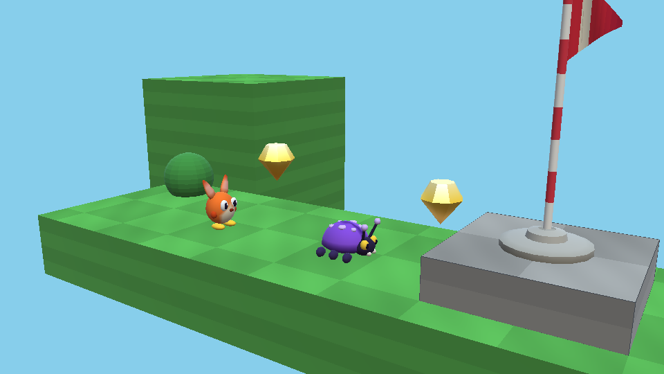

# platformer: one game, four backends, one C library

> **A fixed-tick 3D game in spec-lang.** Skyhop is an original platformer: Pip runs, jumps, rides a moving platform, takes gems, stomps crawlers and reaches a flag. About 620 lines of spec-lang in [`src/`](src/) hold the whole game: rules, levels, frame and the raylib edge. Four model sessions projected it by hand into Rust, TypeScript on Bun, Ruby and C++, each binding [raylib](https://www.raylib.com) 5.5 (C) through its own foreign function interface. The models and the shader come from [ts23d](https://github.com/developerz-ai/ts23d) recipes in [`assets/`](assets/). One suite judges the four, byte for byte where bytes are fixed and pixel for pixel where they depend on the GPU.



## The source

```text
src/
  hop/geom.slg      sub-metres (1/256 m), boxes, overlap and touch: pure integers, no floats
  hop/model.slg     Pad, Player, Solid, Mover, Gem, Crawler, Level
  hop/levels.slg    the meadow and the ridge, on a quarter-metre grid
  hop/physics.slg   one tick of movement: run, jump, coyote time, slide, fall, one-way movers, patrol
  hop/world.slg     the state and two rules, start and step; named start worlds for tests
  hop/render.slg    the frame as data, and as text
  hop/screen.slg    every raylib call, declared `foreign c`, and the rule that draws a frame
  hop/laws.slg      eight laws over any sequence of starts and steps
  hop/tests/        moves, touches, whole winning runs of both levels, raylib against the spec
  apps/{rust,bun,ruby,cpp}.slg   the only files that differ: @target(...)
```

A rule and a pure function, as written (`hop/world.slg`, `hop/physics.slg`):

```slg
@why("a hit or a fall costs a life and sends the hero back to the start; the last one ends the game")
@guard(mode == Playing else Over)
rule lose(why: Text) = {
  out.line("{ticks} {why}");
  lives = lives - 1;
  player = Player(stage.start);
  if lives == 0 {
    mode = Lost;
    out.line("{ticks} lost");
  }
}

@why("a crawler walks to the end of its beat and turns")
@cases(
  Crawler(1, at: Vec3(0, 0, 0), lo: -10, hi: 10, dir: 1, speed: 4) -> Crawler(1, at: Vec3(4, 0, 0), lo: -10, hi: 10, dir: 1, speed: 4),
  Crawler(1, at: Vec3(8, 0, 0), lo: -10, hi: 10, dir: 1, speed: 4) -> Crawler(1, at: Vec3(10, 0, 0), lo: -10, hi: 10, dir: -1, speed: 4),
)
pub fn patrol(c: Crawler) -> Crawler = {
  let x = c.at.x + c.dir * c.speed;
  if x >= c.hi { return c.with(at: c.at.with(x: c.hi), dir: -1); }
  if x <= c.lo { return c.with(at: c.at.with(x: c.lo), dir: 1); }
  return c.with(at: c.at.with(x: x));
}
```

The C library, as written (`hop/screen.slg`), and a law:

```slg
@uses(screen.write)
rule draw_cube(box: Box, color: Rgb) = foreign c "raylib#DrawCube";

pub fn check_collision_boxes(a: Box, b: Box) -> Bool = foreign c "raylib#CheckCollisionBoxes";

@why("the hero is never inside a solid")
law never_inside_a_solid(t: Trace[Play]) =
  t.states.all(w => w.stage.solids.all(s => not geom.overlaps(physics.body(w.player.at), b: s.box)));
```

Not written anywhere in `src/`: the window loop, argument parsing, the input script reader, asset loading, struct layouts, the conversion to `float`. The [`game` vocabulary](docs/game-vocabulary.md) derives them; the [contract](docs/contract.md) fixes their bytes.

## Results

Measured on 2026-11-24, one machine (AMD Ryzen 7 5700X3D, 16 threads, Linux 7.0, Mesa llvmpipe under Xvfb), warm cache, load average about 13 from other builds.

| | Rust | TypeScript (Bun) | Ruby | C++ |
|---|---|---|---|---|
| Projected by | Claude Opus 5.5 | Claude Fable 5.2 | Claude Opus 5.5 | Claude Fable 5.2 |
| Parity, 46 cases | 46/46 | 46/46 | 46/46 | 46/46 |
| `shot` pixel hashes alike | 4/4 | 4/4 | 4/4 | 4/4 |
| Own gate (`out/<b>/bin/check`) | green, 78 tests | green, 172 tests | green, 77 tests | green, 115 tests |
| Product / test lines | 2274 / 1384 | 1534 / 1038 | 1054 / 745 | 2163 / 1672 |
| Lines at the raylib edge | 599 | 547 | 277 | 288 |
| How it calls C | `extern "C"`, `#[repr(C)]` | `bun:ffi` plus a 22-function C shim | the `ffi` gem | `#include "raylib.h"` |
| Executable | 377 KB, links raylib | 111 MB, runtime included | a 744-byte launcher | 107 KB, links raylib |
| Median per command, parity runner | 0.7 ms | 3.8 ms | 35.0 ms | 0.9 ms |

Spec: 621 product lines (start worlds included), 247 test lines, 70 of them the raylib edge. `spec-lang test src --deny warnings`: 89 checks pass and 1 is blocked, `touch_matches_raylib`, which reaches `foreign c` and runs only on a backend, where all four run it against the real library.

Methods: lines from `bun scripts/stats/loc.ts` (non-blank, test by path); edge lines are non-blank lines under each backend's `screen` code (Bun adds its shim). Times from `bun scripts/parity/run.ts`, wall time of each process, median over 71 runs. Sizes from `ls -l`.

What the projections found is in [findings.md](findings.md).

## Run it

```bash
bin/setup                                       # toolchains, raylib 5.5 into vendor/, deps, build all four
bin/skyhop cpp play                             # arrows or WASD to run, space to jump, Esc to quit
bin/skyhop rust play --level 2
bin/skyhop ruby run < parity/inputs/meadow-win.txt
xvfb-run -a bin/skyhop bun shot --at 150 --out frame.png < parity/inputs/meadow-win.txt
bin/check                                       # the gate: spec, scripts, assets, four gates, parity
```

`bin/setup` builds raylib from source and needs the X11 and GL headers (`libxinerama-dev libxcursor-dev libxrandr-dev libxi-dev libgl-dev`) and `xvfb`. For agents: [CLAUDE.md](CLAUDE.md) and the `projector` agent.

## Limits

- Models wrote every file under `out/`; there is no `spec-lang build` for a game app (it refuses one with `E-UNSUPPORTED`). The contract and the vocabulary card are hand-written.
- `play` was opened under a virtual display by the agents; nobody has played it for feel.
- Pixel hashes compare backends on one machine and one driver. They do not say the picture is good; the previews and a person's eyes do.
- Two small levels, one player, no sound. A second game will find what the `game` vocabulary lacks.
- Times are one machine under load from other builds, one run of each command.
