# Call graph

> **Generated.** Projection `diagram --kind calls` of the program's IR, printed by the `view` crate. Do not edit: change the source and regenerate. Same source, same bytes.

## The product

**25 nodes (1 effect, 9 fn, 8 rule, 2 state, 5 type), 44 edges (12 calls, 9 constructs, 8 emits, 8 reads, 7 writes).**

```mermaid
flowchart LR
  subgraph g_todo_board["todo.board"]
    todo_board_tasks[("tasks")]
    todo_board_next_no[("next_no")]
    todo_board_has_tag["has_tag"]
    todo_board_add(["add"])
    todo_board_list(["list"])
    todo_board_done(["done"])
    todo_board_reopen(["reopen"])
    todo_board_rename(["rename"])
    todo_board_remove(["remove"])
    todo_board_clear(["clear"])
    todo_board_stats(["stats"])
  end
  subgraph g_todo_model["todo.model"]
    todo_model_is_title["is_title"]
    todo_model_is_tag["is_tag"]
    todo_model_Title{{"Title"}}
    todo_model_Tag{{"Tag"}}
    todo_model_Status{{"Status"}}
    todo_model_Priority{{"Priority"}}
    todo_model_Task{{"Task"}}
  end
  subgraph g_todo_render["todo.render"]
    todo_render_mark["mark"]
    todo_render_badge["badge"]
    todo_render_tag_text["tag_text"]
    todo_render_urgency["urgency"]
    todo_render_rank["rank"]
    todo_render_line["line"]
  end
  fx_out>"out"]
  todo_board_add --o|"constructs"| todo_model_Priority
  todo_board_add -.->|"reads"| todo_board_next_no
  todo_board_add --o|"constructs"| todo_model_Task
  todo_board_add ==>|"writes"| todo_board_tasks
  todo_board_add ==>|"writes"| todo_board_next_no
  todo_board_add -->|"emits"| fx_out
  todo_board_list -.->|"reads"| todo_board_tasks
  todo_board_list --o|"constructs"| todo_model_Status
  todo_board_list -->|"calls"| todo_board_has_tag
  todo_board_list -->|"calls"| todo_render_rank
  todo_board_list -->|"emits"| fx_out
  todo_board_list -->|"calls"| todo_render_line
  todo_board_done -.->|"reads"| todo_board_tasks
  todo_board_done --o|"constructs"| todo_model_Status
  todo_board_done ==>|"writes"| todo_board_tasks
  todo_board_done -->|"emits"| fx_out
  todo_board_done -->|"calls"| todo_render_line
  todo_board_reopen -.->|"reads"| todo_board_tasks
  todo_board_reopen --o|"constructs"| todo_model_Status
  todo_board_reopen ==>|"writes"| todo_board_tasks
  todo_board_reopen -->|"emits"| fx_out
  todo_board_reopen -->|"calls"| todo_render_line
  todo_board_rename -.->|"reads"| todo_board_tasks
  todo_board_rename ==>|"writes"| todo_board_tasks
  todo_board_rename -->|"emits"| fx_out
  todo_board_rename -->|"calls"| todo_render_line
  todo_board_remove -.->|"reads"| todo_board_tasks
  todo_board_remove ==>|"writes"| todo_board_tasks
  todo_board_remove -->|"emits"| fx_out
  todo_board_clear -.->|"reads"| todo_board_tasks
  todo_board_clear --o|"constructs"| todo_model_Status
  todo_board_clear ==>|"writes"| todo_board_tasks
  todo_board_clear -->|"emits"| fx_out
  todo_board_stats -.->|"reads"| todo_board_tasks
  todo_board_stats --o|"constructs"| todo_model_Status
  todo_board_stats -->|"emits"| fx_out
  todo_model_Title -->|"calls"| todo_model_is_title
  todo_model_Tag -->|"calls"| todo_model_is_tag
  todo_model_Task --o|"constructs"| todo_model_Status
  todo_model_Task --o|"constructs"| todo_model_Priority
  todo_render_rank -->|"calls"| todo_render_urgency
  todo_render_line -->|"calls"| todo_render_mark
  todo_render_line -->|"calls"| todo_render_badge
  todo_render_line -->|"calls"| todo_render_tag_text
  classDef effect stroke:#6b7280,stroke-width:1px,stroke-dasharray:4 3
  class fx_out effect
  classDef rule stroke:#2563eb,stroke-width:2px
  class todo_board_add,todo_board_list,todo_board_done,todo_board_reopen,todo_board_rename,todo_board_remove,todo_board_clear,todo_board_stats rule
  classDef state stroke:#d97706,stroke-width:2px
  class todo_board_tasks,todo_board_next_no state
  classDef type stroke:#7c3aed,stroke-width:1px
  class todo_model_Title,todo_model_Tag,todo_model_Status,todo_model_Priority,todo_model_Task type
```

## With tests and laws

**43 nodes (1 effect, 9 fn, 7 law, 8 rule, 2 state, 10 test, 6 type), 124 edges (28 calls, 15 constructs, 8 emits, 6 given, 4 matches, 17 reads, 2 sets, 37 traces, 7 writes).**

```mermaid
flowchart LR
  subgraph g_todo_board["todo.board"]
    todo_board_tasks[("tasks")]
    todo_board_next_no[("next_no")]
    todo_board_has_tag["has_tag"]
    todo_board_add(["add"])
    todo_board_list(["list"])
    todo_board_done(["done"])
    todo_board_reopen(["reopen"])
    todo_board_rename(["rename"])
    todo_board_remove(["remove"])
    todo_board_clear(["clear"])
    todo_board_stats(["stats"])
    todo_board_three_open_one_done[/"three_open_one_done"/]
  end
  subgraph g_todo_laws["todo.laws"]
    todo_laws_Change{{"Change"}}
    todo_laws_numbers_below_next[\"numbers_below_next"\]
    todo_laws_next_only_grows[\"next_only_grows"\]
    todo_laws_others_untouched[\"others_untouched"\]
    todo_laws_clear_keeps_every_open_task[\"clear_keeps_every_open_task"\]
    todo_laws_reads_change_nothing[\"reads_change_nothing"\]
    todo_laws_refusal_changes_nothing[\"refusal_changes_nothing"\]
    todo_laws_stored_under_its_number[\"stored_under_its_number"\]
  end
  subgraph g_todo_model["todo.model"]
    todo_model_is_title["is_title"]
    todo_model_is_tag["is_tag"]
    todo_model_Title{{"Title"}}
    todo_model_Tag{{"Tag"}}
    todo_model_Status{{"Status"}}
    todo_model_Priority{{"Priority"}}
    todo_model_Task{{"Task"}}
  end
  subgraph g_todo_render["todo.render"]
    todo_render_mark["mark"]
    todo_render_badge["badge"]
    todo_render_tag_text["tag_text"]
    todo_render_urgency["urgency"]
    todo_render_rank["rank"]
    todo_render_line["line"]
  end
  subgraph g_todo_tests_scenarios["todo.tests.scenarios"]
    todo_tests_scenarios_numbers_start_at_one[/"numbers_start_at_one"/]
    todo_tests_scenarios_numbers_are_never_reused[/"numbers_are_never_reused"/]
    todo_tests_scenarios_empty_board_says_so[/"empty_board_says_so"/]
    todo_tests_scenarios_list_ranks_urgent_first[/"list_ranks_urgent_first"/]
    todo_tests_scenarios_list_all_and_by_tag[/"list_all_and_by_tag"/]
    todo_tests_scenarios_done_and_reopen_move_once[/"done_and_reopen_move_once"/]
    todo_tests_scenarios_rename_keeps_the_rest[/"rename_keeps_the_rest"/]
    todo_tests_scenarios_clear_removes_only_done[/"clear_removes_only_done"/]
    todo_tests_scenarios_unknown_numbers_are_refused[/"unknown_numbers_are_refused"/]
  end
  fx_out>"out"]
  todo_board_add --o|"constructs"| todo_model_Priority
  todo_board_add -.->|"reads"| todo_board_next_no
  todo_board_add --o|"constructs"| todo_model_Task
  todo_board_add ==>|"writes"| todo_board_tasks
  todo_board_add ==>|"writes"| todo_board_next_no
  todo_board_add -->|"emits"| fx_out
  todo_board_list -.->|"reads"| todo_board_tasks
  todo_board_list --o|"constructs"| todo_model_Status
  todo_board_list -->|"calls"| todo_board_has_tag
  todo_board_list -->|"calls"| todo_render_rank
  todo_board_list -->|"emits"| fx_out
  todo_board_list -->|"calls"| todo_render_line
  todo_board_done -.->|"reads"| todo_board_tasks
  todo_board_done --o|"constructs"| todo_model_Status
  todo_board_done ==>|"writes"| todo_board_tasks
  todo_board_done -->|"emits"| fx_out
  todo_board_done -->|"calls"| todo_render_line
  todo_board_reopen -.->|"reads"| todo_board_tasks
  todo_board_reopen --o|"constructs"| todo_model_Status
  todo_board_reopen ==>|"writes"| todo_board_tasks
  todo_board_reopen -->|"emits"| fx_out
  todo_board_reopen -->|"calls"| todo_render_line
  todo_board_rename -.->|"reads"| todo_board_tasks
  todo_board_rename ==>|"writes"| todo_board_tasks
  todo_board_rename -->|"emits"| fx_out
  todo_board_rename -->|"calls"| todo_render_line
  todo_board_remove -.->|"reads"| todo_board_tasks
  todo_board_remove ==>|"writes"| todo_board_tasks
  todo_board_remove -->|"emits"| fx_out
  todo_board_clear -.->|"reads"| todo_board_tasks
  todo_board_clear --o|"constructs"| todo_model_Status
  todo_board_clear ==>|"writes"| todo_board_tasks
  todo_board_clear -->|"emits"| fx_out
  todo_board_stats -.->|"reads"| todo_board_tasks
  todo_board_stats --o|"constructs"| todo_model_Status
  todo_board_stats -->|"emits"| fx_out
  todo_board_three_open_one_done ==>|"sets"| todo_board_tasks
  todo_board_three_open_one_done --o|"constructs"| todo_model_Task
  todo_board_three_open_one_done --o|"constructs"| todo_model_Priority
  todo_board_three_open_one_done --o|"constructs"| todo_model_Status
  todo_board_three_open_one_done ==>|"sets"| todo_board_next_no
  todo_laws_Change -->|"traces"| todo_board_add
  todo_laws_Change -->|"traces"| todo_board_done
  todo_laws_Change -->|"traces"| todo_board_reopen
  todo_laws_Change -->|"traces"| todo_board_rename
  todo_laws_Change -->|"traces"| todo_board_remove
  todo_laws_Change -->|"traces"| todo_board_clear
  todo_laws_numbers_below_next -->|"traces"| todo_board_add
  todo_laws_numbers_below_next -->|"traces"| todo_board_done
  todo_laws_numbers_below_next -->|"traces"| todo_board_reopen
  todo_laws_numbers_below_next -->|"traces"| todo_board_rename
  todo_laws_numbers_below_next -->|"traces"| todo_board_remove
  todo_laws_numbers_below_next -->|"traces"| todo_board_clear
  todo_laws_next_only_grows -->|"traces"| todo_board_add
  todo_laws_others_untouched -->|"traces"| todo_board_done
  todo_laws_others_untouched -->|"traces"| todo_board_reopen
  todo_laws_others_untouched -->|"traces"| todo_board_rename
  todo_laws_others_untouched -->|"traces"| todo_board_remove
  todo_laws_clear_keeps_every_open_task -->|"traces"| todo_board_add
  todo_laws_clear_keeps_every_open_task -->|"traces"| todo_board_done
  todo_laws_clear_keeps_every_open_task -->|"traces"| todo_board_reopen
  todo_laws_clear_keeps_every_open_task -->|"traces"| todo_board_rename
  todo_laws_clear_keeps_every_open_task -->|"traces"| todo_board_remove
  todo_laws_clear_keeps_every_open_task -->|"traces"| todo_board_clear
  todo_laws_clear_keeps_every_open_task -.->|"matches"| todo_board_clear
  todo_laws_clear_keeps_every_open_task --o|"constructs"| todo_model_Status
  todo_laws_reads_change_nothing -->|"traces"| todo_board_list
  todo_laws_reads_change_nothing -->|"traces"| todo_board_stats
  todo_laws_refusal_changes_nothing -->|"traces"| todo_board_add
  todo_laws_refusal_changes_nothing -->|"traces"| todo_board_done
  todo_laws_refusal_changes_nothing -->|"traces"| todo_board_reopen
  todo_laws_refusal_changes_nothing -->|"traces"| todo_board_rename
  todo_laws_refusal_changes_nothing -->|"traces"| todo_board_remove
  todo_laws_refusal_changes_nothing -->|"traces"| todo_board_clear
  todo_laws_stored_under_its_number -->|"traces"| todo_board_add
  todo_laws_stored_under_its_number -->|"traces"| todo_board_done
  todo_laws_stored_under_its_number -->|"traces"| todo_board_reopen
  todo_laws_stored_under_its_number -->|"traces"| todo_board_rename
  todo_laws_stored_under_its_number -->|"traces"| todo_board_remove
  todo_laws_stored_under_its_number -->|"traces"| todo_board_clear
  todo_model_Title -->|"calls"| todo_model_is_title
  todo_model_Tag -->|"calls"| todo_model_is_tag
  todo_model_Task --o|"constructs"| todo_model_Status
  todo_model_Task --o|"constructs"| todo_model_Priority
  todo_render_mark -.->|"matches"| todo_model_Status
  todo_render_badge -.->|"matches"| todo_model_Priority
  todo_render_urgency -.->|"matches"| todo_model_Priority
  todo_render_rank -->|"calls"| todo_render_urgency
  todo_render_line -->|"calls"| todo_render_mark
  todo_render_line -->|"calls"| todo_render_badge
  todo_render_line -->|"calls"| todo_render_tag_text
  todo_tests_scenarios_numbers_start_at_one -->|"calls"| todo_board_add
  todo_tests_scenarios_numbers_start_at_one -.->|"reads"| fx_out
  todo_tests_scenarios_numbers_are_never_reused -->|"calls"| todo_board_add
  todo_tests_scenarios_numbers_are_never_reused -->|"calls"| todo_board_remove
  todo_tests_scenarios_empty_board_says_so -->|"calls"| todo_board_list
  todo_tests_scenarios_empty_board_says_so -->|"calls"| todo_board_stats
  todo_tests_scenarios_empty_board_says_so -.->|"reads"| fx_out
  todo_tests_scenarios_list_ranks_urgent_first -->|"given"| todo_board_three_open_one_done
  todo_tests_scenarios_list_ranks_urgent_first -->|"calls"| todo_board_list
  todo_tests_scenarios_list_ranks_urgent_first -.->|"reads"| fx_out
  todo_tests_scenarios_list_all_and_by_tag -->|"given"| todo_board_three_open_one_done
  todo_tests_scenarios_list_all_and_by_tag -->|"calls"| todo_board_list
  todo_tests_scenarios_list_all_and_by_tag -.->|"reads"| fx_out
  todo_tests_scenarios_done_and_reopen_move_once -->|"given"| todo_board_three_open_one_done
  todo_tests_scenarios_done_and_reopen_move_once -->|"calls"| todo_board_done
  todo_tests_scenarios_done_and_reopen_move_once -->|"calls"| todo_board_reopen
  todo_tests_scenarios_done_and_reopen_move_once -.->|"reads"| fx_out
  todo_tests_scenarios_rename_keeps_the_rest -->|"given"| todo_board_three_open_one_done
  todo_tests_scenarios_rename_keeps_the_rest -->|"calls"| todo_board_rename
  todo_tests_scenarios_rename_keeps_the_rest -.->|"reads"| todo_board_tasks
  todo_tests_scenarios_rename_keeps_the_rest --o|"constructs"| todo_model_Task
  todo_tests_scenarios_rename_keeps_the_rest --o|"constructs"| todo_model_Priority
  todo_tests_scenarios_clear_removes_only_done -->|"given"| todo_board_three_open_one_done
  todo_tests_scenarios_clear_removes_only_done -->|"calls"| todo_board_clear
  todo_tests_scenarios_clear_removes_only_done -->|"calls"| todo_board_stats
  todo_tests_scenarios_clear_removes_only_done -.->|"reads"| fx_out
  todo_tests_scenarios_clear_removes_only_done -.->|"reads"| todo_board_tasks
  todo_tests_scenarios_unknown_numbers_are_refused -->|"given"| todo_board_three_open_one_done
  todo_tests_scenarios_unknown_numbers_are_refused -->|"calls"| todo_board_done
  todo_tests_scenarios_unknown_numbers_are_refused -->|"calls"| todo_board_reopen
  todo_tests_scenarios_unknown_numbers_are_refused -->|"calls"| todo_board_rename
  todo_tests_scenarios_unknown_numbers_are_refused -->|"calls"| todo_board_remove
  todo_tests_scenarios_unknown_numbers_are_refused -.->|"reads"| fx_out
  classDef effect stroke:#6b7280,stroke-width:1px,stroke-dasharray:4 3
  class fx_out effect
  classDef law stroke:#059669,stroke-width:2px
  class todo_laws_numbers_below_next,todo_laws_next_only_grows,todo_laws_others_untouched,todo_laws_clear_keeps_every_open_task,todo_laws_reads_change_nothing,todo_laws_refusal_changes_nothing,todo_laws_stored_under_its_number law
  classDef rule stroke:#2563eb,stroke-width:2px
  class todo_board_add,todo_board_list,todo_board_done,todo_board_reopen,todo_board_rename,todo_board_remove,todo_board_clear,todo_board_stats rule
  classDef state stroke:#d97706,stroke-width:2px
  class todo_board_tasks,todo_board_next_no state
  classDef test stroke:#059669,stroke-width:1px
  class todo_board_three_open_one_done,todo_tests_scenarios_numbers_start_at_one,todo_tests_scenarios_numbers_are_never_reused,todo_tests_scenarios_empty_board_says_so,todo_tests_scenarios_list_ranks_urgent_first,todo_tests_scenarios_list_all_and_by_tag,todo_tests_scenarios_done_and_reopen_move_once,todo_tests_scenarios_rename_keeps_the_rest,todo_tests_scenarios_clear_removes_only_done,todo_tests_scenarios_unknown_numbers_are_refused test
  classDef type stroke:#7c3aed,stroke-width:1px
  class todo_laws_Change,todo_model_Title,todo_model_Tag,todo_model_Status,todo_model_Priority,todo_model_Task type
```

## Limits

- Core library methods (`filter`, `sort`, `size`) are not declarations and are not drawn.
- A type is drawn only where it is constructed or matched; a type in a signature is an `impact` edge, not a call edge.
- A law's reads of `before` and `after` worlds are not edges: the IR resolves them when the law runs.
- `@cases` rows are not edges.
