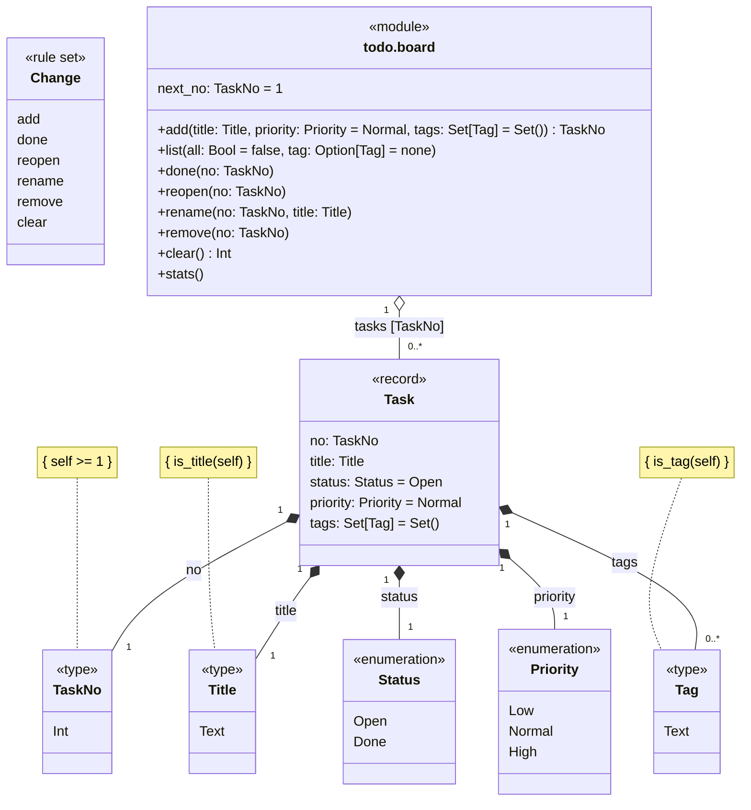

# Class diagram

> **Generated.** Projection `diagram --kind class` of the program's IR, printed by the `view` crate. Do not edit: change the source and regenerate. Same source, same bytes.

**8 classes, 6 relations.**

| Class | Kind | Declaration | Constraints |
|---|---|---|---|
| `Change` | rule set | `todo.laws.Change` | - |
| `Title` | type | `todo.model.Title` | `is_title(self)` |
| `Tag` | type | `todo.model.Tag` | `is_tag(self)` |
| `TaskNo` | type | `todo.model.TaskNo` | `self >= 1` |
| `Status` | enumeration | `todo.model.Status` | - |
| `Priority` | enumeration | `todo.model.Priority` | - |
| `Task` | record | `todo.model.Task` | - |
| `todo.board` | module | `todo.board` | - |

A note `{ claim }` is a constraint every value of the type satisfies. A filled diamond is a field (the record holds the value); a hollow diamond is a module's `state`, labelled with the map key in brackets.

## Limits

- Functions are not drawn; a claim that calls one shows the call as text only.
- A type named only through `Trace[...]` or a rule set has no relation line.
- Multiplicity is read off the type (`Option`, `List`, `Set`, `Map`), not off claims that bound a size.
