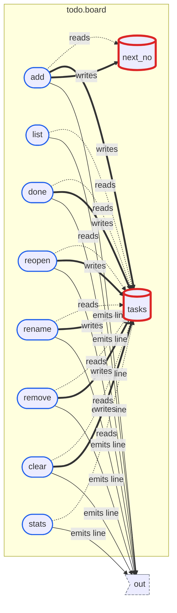
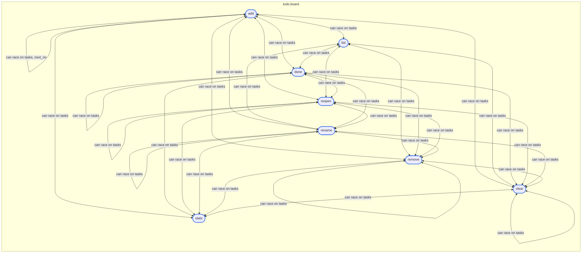

# Effects

> **Generated.** Projection `diagram --kind effects` of the program's IR, printed by the `view` crate. Do not edit: change the source and regenerate. Same source, same bytes.

**11 nodes (1 effect, 8 rule, 2 state), 23 edges (8 emits, 8 reads, 7 writes).** A state with a red border is written by one rule and read or written by another.

| Rule | `@uses` | Reads | Writes | Outside | Not in `@uses` | In `@uses`, not found |
|---|---|---|---|---|---|---|
| `todo.board.add` | `tasks.write`, `next_no.write`, `out.write` | `todo.board.next_no` | `todo.board.tasks`, `todo.board.next_no` | `out.line` | - | - |
| `todo.board.list` | `tasks.read`, `out.write` | `todo.board.tasks` | - | `out.line` | - | - |
| `todo.board.done` | `tasks.write`, `out.write` | `todo.board.tasks` | `todo.board.tasks` | `out.line` | - | - |
| `todo.board.reopen` | `tasks.write`, `out.write` | `todo.board.tasks` | `todo.board.tasks` | `out.line` | - | - |
| `todo.board.rename` | `tasks.write`, `out.write` | `todo.board.tasks` | `todo.board.tasks` | `out.line` | - | - |
| `todo.board.remove` | `tasks.write`, `out.write` | `todo.board.tasks` | `todo.board.tasks` | `out.line` | - | - |
| `todo.board.clear` | `tasks.write`, `out.write` | `todo.board.tasks` | `todo.board.tasks` | `out.line` | - | - |
| `todo.board.stats` | `tasks.read`, `out.write` | `todo.board.tasks` | - | `out.line` | - | - |

## Rules whose order matters

**33 pairs** (8 nodes, 33 edges). One rule writes a state the other reads or writes. Each rule is atomic, so nothing is torn; the result depends on which commits first. A loop on one rule is two calls of it.

| Rule | Rule | Shared state |
|---|---|---|
| `todo.board.add` | `todo.board.add` | `todo.board.tasks`, `todo.board.next_no` |
| `todo.board.add` | `todo.board.list` | `todo.board.tasks` |
| `todo.board.add` | `todo.board.done` | `todo.board.tasks` |
| `todo.board.add` | `todo.board.reopen` | `todo.board.tasks` |
| `todo.board.add` | `todo.board.rename` | `todo.board.tasks` |
| `todo.board.add` | `todo.board.remove` | `todo.board.tasks` |
| `todo.board.add` | `todo.board.clear` | `todo.board.tasks` |
| `todo.board.add` | `todo.board.stats` | `todo.board.tasks` |
| `todo.board.list` | `todo.board.done` | `todo.board.tasks` |
| `todo.board.list` | `todo.board.reopen` | `todo.board.tasks` |
| `todo.board.list` | `todo.board.rename` | `todo.board.tasks` |
| `todo.board.list` | `todo.board.remove` | `todo.board.tasks` |
| `todo.board.list` | `todo.board.clear` | `todo.board.tasks` |
| `todo.board.done` | `todo.board.done` | `todo.board.tasks` |
| `todo.board.done` | `todo.board.reopen` | `todo.board.tasks` |
| `todo.board.done` | `todo.board.rename` | `todo.board.tasks` |
| `todo.board.done` | `todo.board.remove` | `todo.board.tasks` |
| `todo.board.done` | `todo.board.clear` | `todo.board.tasks` |
| `todo.board.done` | `todo.board.stats` | `todo.board.tasks` |
| `todo.board.reopen` | `todo.board.reopen` | `todo.board.tasks` |
| `todo.board.reopen` | `todo.board.rename` | `todo.board.tasks` |
| `todo.board.reopen` | `todo.board.remove` | `todo.board.tasks` |
| `todo.board.reopen` | `todo.board.clear` | `todo.board.tasks` |
| `todo.board.reopen` | `todo.board.stats` | `todo.board.tasks` |
| `todo.board.rename` | `todo.board.rename` | `todo.board.tasks` |
| `todo.board.rename` | `todo.board.remove` | `todo.board.tasks` |
| `todo.board.rename` | `todo.board.clear` | `todo.board.tasks` |
| `todo.board.rename` | `todo.board.stats` | `todo.board.tasks` |
| `todo.board.remove` | `todo.board.remove` | `todo.board.tasks` |
| `todo.board.remove` | `todo.board.clear` | `todo.board.tasks` |
| `todo.board.remove` | `todo.board.stats` | `todo.board.tasks` |
| `todo.board.clear` | `todo.board.clear` | `todo.board.tasks` |
| `todo.board.clear` | `todo.board.stats` | `todo.board.tasks` |

## Limits

- Sets are per state, not per key: two rules that touch different entries of one map are still listed as a pair.
- Sets are what a rule can touch on some path, not what every call touches.
- `out` is left out of the pairs: lines are sent after commit.
- `@uses` is compared by name; the IR records it and does not check it.
