# Impact

> **Generated.** Projection `diagram --kind impact <decl>` of the program's IR, printed by the `view` crate. Do not edit: change the source and regenerate. Same source, same bytes.

What may behave differently when a declaration changes: everything that names it, directly or through something that does. In a graph an arrow points at what is depended on, and is drawn where it leads one step closer to the declaration asked about: every shortest reason, not every reference.

| Declaration | Kind | Direct | Functions | Rules | Tests | Laws | `@cases` | Apps | All | Generated files |
|---|---|---|---|---|---|---|---|---|---|---|
| `apps.bun.TodoBun` | app | 0 | 0 | 0 | 0 | 0 | 0 | 0 | 0 | 0 |
| `apps.cpp.TodoCpp` | app | 0 | 0 | 0 | 0 | 0 | 0 | 0 | 0 | 0 |
| `apps.ruby.TodoRuby` | app | 0 | 0 | 0 | 0 | 0 | 0 | 0 | 0 | 0 |
| `apps.rust.TodoRust` | app | 0 | 0 | 0 | 0 | 0 | 0 | 0 | 0 | 0 |
| `todo.board.tasks` | state | 11 | 0 | 8 | 10 | 7 | 0 | 4 | 30 | 0 |
| `todo.board.next_no` | state | 2 | 0 | 1 | 9 | 5 | 0 | 4 | 20 | 0 |
| `todo.board.has_tag` | fn | 1 | 0 | 1 | 3 | 1 | 0 | 4 | 9 | 0 |
| `todo.board.add` | rule | 12 | 0 | 0 | 2 | 5 | 0 | 4 | 12 | 0 |
| `todo.board.list` | rule | 8 | 0 | 0 | 3 | 1 | 0 | 4 | 8 | 0 |
| `todo.board.done` | rule | 12 | 0 | 0 | 2 | 5 | 0 | 4 | 12 | 0 |
| `todo.board.reopen` | rule | 12 | 0 | 0 | 2 | 5 | 0 | 4 | 12 | 0 |
| `todo.board.rename` | rule | 12 | 0 | 0 | 2 | 5 | 0 | 4 | 12 | 0 |
| `todo.board.remove` | rule | 12 | 0 | 0 | 2 | 5 | 0 | 4 | 12 | 0 |
| `todo.board.clear` | rule | 10 | 0 | 0 | 1 | 4 | 0 | 4 | 10 | 0 |
| `todo.board.stats` | rule | 7 | 0 | 0 | 2 | 1 | 0 | 4 | 7 | 0 |
| `todo.board.three_open_one_done` | test | 6 | 0 | 0 | 6 | 0 | 0 | 0 | 6 | 0 |
| `todo.laws.Change` | type | 0 | 0 | 0 | 0 | 0 | 0 | 0 | 0 | 0 |
| `todo.laws.numbers_below_next` | law | 0 | 0 | 0 | 0 | 0 | 0 | 0 | 0 | 0 |
| `todo.laws.next_only_grows` | law | 0 | 0 | 0 | 0 | 0 | 0 | 0 | 0 | 0 |
| `todo.laws.others_untouched` | law | 0 | 0 | 0 | 0 | 0 | 0 | 0 | 0 | 0 |
| `todo.laws.clear_keeps_every_open_task` | law | 0 | 0 | 0 | 0 | 0 | 0 | 0 | 0 | 0 |
| `todo.laws.reads_change_nothing` | law | 0 | 0 | 0 | 0 | 0 | 0 | 0 | 0 | 0 |
| `todo.laws.refusal_changes_nothing` | law | 0 | 0 | 0 | 0 | 0 | 0 | 0 | 0 | 0 |
| `todo.laws.stored_under_its_number` | law | 0 | 0 | 0 | 0 | 0 | 0 | 0 | 0 | 0 |
| `todo.model.is_title` | fn | 1 | 3 | 8 | 10 | 7 | 2 | 4 | 36 | 0 |
| `todo.model.is_tag` | fn | 1 | 4 | 8 | 10 | 7 | 3 | 4 | 37 | 0 |
| `todo.model.Title` | type | 3 | 3 | 8 | 10 | 7 | 1 | 4 | 35 | 0 |
| `todo.model.Tag` | type | 5 | 4 | 8 | 10 | 7 | 2 | 4 | 36 | 0 |
| `todo.model.TaskNo` | type | 10 | 3 | 8 | 10 | 7 | 1 | 4 | 36 | 0 |
| `todo.model.Status` | type | 9 | 4 | 8 | 10 | 7 | 1 | 4 | 36 | 0 |
| `todo.model.Priority` | type | 6 | 5 | 8 | 10 | 7 | 1 | 4 | 37 | 0 |
| `todo.model.Task` | type | 7 | 3 | 8 | 10 | 7 | 1 | 4 | 34 | 0 |
| `todo.render.mark` | fn | 1 | 1 | 4 | 6 | 6 | 1 | 4 | 22 | 0 |
| `todo.render.badge` | fn | 1 | 1 | 4 | 6 | 6 | 1 | 4 | 22 | 0 |
| `todo.render.tag_text` | fn | 1 | 1 | 4 | 6 | 6 | 2 | 4 | 22 | 0 |
| `todo.render.urgency` | fn | 1 | 1 | 1 | 3 | 1 | 0 | 4 | 10 | 0 |
| `todo.render.rank` | fn | 1 | 0 | 1 | 3 | 1 | 0 | 4 | 9 | 0 |
| `todo.render.line` | fn | 4 | 0 | 4 | 6 | 6 | 1 | 4 | 21 | 0 |
| `todo.tests.scenarios.numbers_start_at_one` | test | 0 | 0 | 0 | 0 | 0 | 0 | 0 | 0 | 0 |
| `todo.tests.scenarios.numbers_are_never_reused` | test | 0 | 0 | 0 | 0 | 0 | 0 | 0 | 0 | 0 |
| `todo.tests.scenarios.empty_board_says_so` | test | 0 | 0 | 0 | 0 | 0 | 0 | 0 | 0 | 0 |
| `todo.tests.scenarios.list_ranks_urgent_first` | test | 0 | 0 | 0 | 0 | 0 | 0 | 0 | 0 | 0 |
| `todo.tests.scenarios.list_all_and_by_tag` | test | 0 | 0 | 0 | 0 | 0 | 0 | 0 | 0 | 0 |
| `todo.tests.scenarios.done_and_reopen_move_once` | test | 0 | 0 | 0 | 0 | 0 | 0 | 0 | 0 | 0 |
| `todo.tests.scenarios.rename_keeps_the_rest` | test | 0 | 0 | 0 | 0 | 0 | 0 | 0 | 0 | 0 |
| `todo.tests.scenarios.clear_removes_only_done` | test | 0 | 0 | 0 | 0 | 0 | 0 | 0 | 0 | 0 |
| `todo.tests.scenarios.unknown_numbers_are_refused` | test | 0 | 0 | 0 | 0 | 0 | 0 | 0 | 0 | 0 |

## `todo.board.tasks`

**31 nodes (4 app, 7 law, 8 rule, 1 state, 10 test, 1 type), 103 edges (13 calls, 32 exposes, 4 given, 1 matches, 9 reads, 1 sets, 37 traces, 6 writes).**

```mermaid
flowchart RL
  subgraph g_apps_bun["apps.bun"]
    apps_bun_TodoBun[["TodoBun"]]
  end
  subgraph g_apps_cpp["apps.cpp"]
    apps_cpp_TodoCpp[["TodoCpp"]]
  end
  subgraph g_apps_ruby["apps.ruby"]
    apps_ruby_TodoRuby[["TodoRuby"]]
  end
  subgraph g_apps_rust["apps.rust"]
    apps_rust_TodoRust[["TodoRust"]]
  end
  subgraph g_todo_board["todo.board"]
    todo_board_tasks[("tasks")]
    todo_board_add(["add"])
    todo_board_list(["list"])
    todo_board_done(["done"])
    todo_board_reopen(["reopen"])
    todo_board_rename(["rename"])
    todo_board_remove(["remove"])
    todo_board_clear(["clear"])
    todo_board_stats(["stats"])
    todo_board_three_open_one_done[/"three_open_one_done"/]
  end
  subgraph g_todo_laws["todo.laws"]
    todo_laws_Change{{"Change"}}
    todo_laws_numbers_below_next[\"numbers_below_next"\]
    todo_laws_next_only_grows[\"next_only_grows"\]
    todo_laws_others_untouched[\"others_untouched"\]
    todo_laws_clear_keeps_every_open_task[\"clear_keeps_every_open_task"\]
    todo_laws_reads_change_nothing[\"reads_change_nothing"\]
    todo_laws_refusal_changes_nothing[\"refusal_changes_nothing"\]
    todo_laws_stored_under_its_number[\"stored_under_its_number"\]
  end
  subgraph g_todo_tests_scenarios["todo.tests.scenarios"]
    todo_tests_scenarios_numbers_start_at_one[/"numbers_start_at_one"/]
    todo_tests_scenarios_numbers_are_never_reused[/"numbers_are_never_reused"/]
    todo_tests_scenarios_empty_board_says_so[/"empty_board_says_so"/]
    todo_tests_scenarios_list_ranks_urgent_first[/"list_ranks_urgent_first"/]
    todo_tests_scenarios_list_all_and_by_tag[/"list_all_and_by_tag"/]
    todo_tests_scenarios_done_and_reopen_move_once[/"done_and_reopen_move_once"/]
    todo_tests_scenarios_rename_keeps_the_rest[/"rename_keeps_the_rest"/]
    todo_tests_scenarios_clear_removes_only_done[/"clear_removes_only_done"/]
    todo_tests_scenarios_unknown_numbers_are_refused[/"unknown_numbers_are_refused"/]
  end
  apps_bun_TodoBun -->|"exposes"| todo_board_add
  apps_bun_TodoBun -->|"exposes"| todo_board_list
  apps_bun_TodoBun -->|"exposes"| todo_board_done
  apps_bun_TodoBun -->|"exposes"| todo_board_reopen
  apps_bun_TodoBun -->|"exposes"| todo_board_rename
  apps_bun_TodoBun -->|"exposes"| todo_board_remove
  apps_bun_TodoBun -->|"exposes"| todo_board_clear
  apps_bun_TodoBun -->|"exposes"| todo_board_stats
  apps_cpp_TodoCpp -->|"exposes"| todo_board_add
  apps_cpp_TodoCpp -->|"exposes"| todo_board_list
  apps_cpp_TodoCpp -->|"exposes"| todo_board_done
  apps_cpp_TodoCpp -->|"exposes"| todo_board_reopen
  apps_cpp_TodoCpp -->|"exposes"| todo_board_rename
  apps_cpp_TodoCpp -->|"exposes"| todo_board_remove
  apps_cpp_TodoCpp -->|"exposes"| todo_board_clear
  apps_cpp_TodoCpp -->|"exposes"| todo_board_stats
  apps_ruby_TodoRuby -->|"exposes"| todo_board_add
  apps_ruby_TodoRuby -->|"exposes"| todo_board_list
  apps_ruby_TodoRuby -->|"exposes"| todo_board_done
  apps_ruby_TodoRuby -->|"exposes"| todo_board_reopen
  apps_ruby_TodoRuby -->|"exposes"| todo_board_rename
  apps_ruby_TodoRuby -->|"exposes"| todo_board_remove
  apps_ruby_TodoRuby -->|"exposes"| todo_board_clear
  apps_ruby_TodoRuby -->|"exposes"| todo_board_stats
  apps_rust_TodoRust -->|"exposes"| todo_board_add
  apps_rust_TodoRust -->|"exposes"| todo_board_list
  apps_rust_TodoRust -->|"exposes"| todo_board_done
  apps_rust_TodoRust -->|"exposes"| todo_board_reopen
  apps_rust_TodoRust -->|"exposes"| todo_board_rename
  apps_rust_TodoRust -->|"exposes"| todo_board_remove
  apps_rust_TodoRust -->|"exposes"| todo_board_clear
  apps_rust_TodoRust -->|"exposes"| todo_board_stats
  todo_board_add ==>|"writes"| todo_board_tasks
  todo_board_list -.->|"reads"| todo_board_tasks
  todo_board_done -.->|"reads"| todo_board_tasks
  todo_board_done ==>|"writes"| todo_board_tasks
  todo_board_reopen -.->|"reads"| todo_board_tasks
  todo_board_reopen ==>|"writes"| todo_board_tasks
  todo_board_rename -.->|"reads"| todo_board_tasks
  todo_board_rename ==>|"writes"| todo_board_tasks
  todo_board_remove -.->|"reads"| todo_board_tasks
  todo_board_remove ==>|"writes"| todo_board_tasks
  todo_board_clear -.->|"reads"| todo_board_tasks
  todo_board_clear ==>|"writes"| todo_board_tasks
  todo_board_stats -.->|"reads"| todo_board_tasks
  todo_board_three_open_one_done ==>|"sets"| todo_board_tasks
  todo_laws_Change -->|"traces"| todo_board_add
  todo_laws_Change -->|"traces"| todo_board_done
  todo_laws_Change -->|"traces"| todo_board_reopen
  todo_laws_Change -->|"traces"| todo_board_rename
  todo_laws_Change -->|"traces"| todo_board_remove
  todo_laws_Change -->|"traces"| todo_board_clear
  todo_laws_numbers_below_next -->|"traces"| todo_board_add
  todo_laws_numbers_below_next -->|"traces"| todo_board_done
  todo_laws_numbers_below_next -->|"traces"| todo_board_reopen
  todo_laws_numbers_below_next -->|"traces"| todo_board_rename
  todo_laws_numbers_below_next -->|"traces"| todo_board_remove
  todo_laws_numbers_below_next -->|"traces"| todo_board_clear
  todo_laws_next_only_grows -->|"traces"| todo_board_add
  todo_laws_others_untouched -->|"traces"| todo_board_done
  todo_laws_others_untouched -->|"traces"| todo_board_reopen
  todo_laws_others_untouched -->|"traces"| todo_board_rename
  todo_laws_others_untouched -->|"traces"| todo_board_remove
  todo_laws_clear_keeps_every_open_task -->|"traces"| todo_board_add
  todo_laws_clear_keeps_every_open_task -->|"traces"| todo_board_done
  todo_laws_clear_keeps_every_open_task -->|"traces"| todo_board_reopen
  todo_laws_clear_keeps_every_open_task -->|"traces"| todo_board_rename
  todo_laws_clear_keeps_every_open_task -->|"traces"| todo_board_remove
  todo_laws_clear_keeps_every_open_task -->|"traces"| todo_board_clear
  todo_laws_clear_keeps_every_open_task -.->|"matches"| todo_board_clear
  todo_laws_reads_change_nothing -->|"traces"| todo_board_list
  todo_laws_reads_change_nothing -->|"traces"| todo_board_stats
  todo_laws_refusal_changes_nothing -->|"traces"| todo_board_add
  todo_laws_refusal_changes_nothing -->|"traces"| todo_board_done
  todo_laws_refusal_changes_nothing -->|"traces"| todo_board_reopen
  todo_laws_refusal_changes_nothing -->|"traces"| todo_board_rename
  todo_laws_refusal_changes_nothing -->|"traces"| todo_board_remove
  todo_laws_refusal_changes_nothing -->|"traces"| todo_board_clear
  todo_laws_stored_under_its_number -->|"traces"| todo_board_add
  todo_laws_stored_under_its_number -->|"traces"| todo_board_done
  todo_laws_stored_under_its_number -->|"traces"| todo_board_reopen
  todo_laws_stored_under_its_number -->|"traces"| todo_board_rename
  todo_laws_stored_under_its_number -->|"traces"| todo_board_remove
  todo_laws_stored_under_its_number -->|"traces"| todo_board_clear
  todo_tests_scenarios_numbers_start_at_one -->|"calls"| todo_board_add
  todo_tests_scenarios_numbers_are_never_reused -->|"calls"| todo_board_add
  todo_tests_scenarios_numbers_are_never_reused -->|"calls"| todo_board_remove
  todo_tests_scenarios_empty_board_says_so -->|"calls"| todo_board_list
  todo_tests_scenarios_empty_board_says_so -->|"calls"| todo_board_stats
  todo_tests_scenarios_list_ranks_urgent_first -->|"given"| todo_board_three_open_one_done
  todo_tests_scenarios_list_ranks_urgent_first -->|"calls"| todo_board_list
  todo_tests_scenarios_list_all_and_by_tag -->|"given"| todo_board_three_open_one_done
  todo_tests_scenarios_list_all_and_by_tag -->|"calls"| todo_board_list
  todo_tests_scenarios_done_and_reopen_move_once -->|"given"| todo_board_three_open_one_done
  todo_tests_scenarios_done_and_reopen_move_once -->|"calls"| todo_board_done
  todo_tests_scenarios_done_and_reopen_move_once -->|"calls"| todo_board_reopen
  todo_tests_scenarios_rename_keeps_the_rest -.->|"reads"| todo_board_tasks
  todo_tests_scenarios_clear_removes_only_done -.->|"reads"| todo_board_tasks
  todo_tests_scenarios_unknown_numbers_are_refused -->|"given"| todo_board_three_open_one_done
  todo_tests_scenarios_unknown_numbers_are_refused -->|"calls"| todo_board_done
  todo_tests_scenarios_unknown_numbers_are_refused -->|"calls"| todo_board_reopen
  todo_tests_scenarios_unknown_numbers_are_refused -->|"calls"| todo_board_rename
  todo_tests_scenarios_unknown_numbers_are_refused -->|"calls"| todo_board_remove
  classDef app stroke:#db2777,stroke-width:2px
  class apps_bun_TodoBun,apps_cpp_TodoCpp,apps_ruby_TodoRuby,apps_rust_TodoRust app
  classDef law stroke:#059669,stroke-width:2px
  class todo_laws_numbers_below_next,todo_laws_next_only_grows,todo_laws_others_untouched,todo_laws_clear_keeps_every_open_task,todo_laws_reads_change_nothing,todo_laws_refusal_changes_nothing,todo_laws_stored_under_its_number law
  classDef rule stroke:#2563eb,stroke-width:2px
  class todo_board_add,todo_board_list,todo_board_done,todo_board_reopen,todo_board_rename,todo_board_remove,todo_board_clear,todo_board_stats rule
  classDef state stroke:#d97706,stroke-width:2px
  class todo_board_tasks state
  classDef test stroke:#059669,stroke-width:1px
  class todo_board_three_open_one_done,todo_tests_scenarios_numbers_start_at_one,todo_tests_scenarios_numbers_are_never_reused,todo_tests_scenarios_empty_board_says_so,todo_tests_scenarios_list_ranks_urgent_first,todo_tests_scenarios_list_all_and_by_tag,todo_tests_scenarios_done_and_reopen_move_once,todo_tests_scenarios_rename_keeps_the_rest,todo_tests_scenarios_clear_removes_only_done,todo_tests_scenarios_unknown_numbers_are_refused test
  classDef type stroke:#7c3aed,stroke-width:1px
  class todo_laws_Change type
  classDef hot stroke:#dc2626,stroke-width:4px
  class todo_board_tasks hot
```

- Tests: `todo.board.three_open_one_done`, `todo.tests.scenarios.numbers_start_at_one`, `todo.tests.scenarios.numbers_are_never_reused`, `todo.tests.scenarios.empty_board_says_so`, `todo.tests.scenarios.list_ranks_urgent_first`, `todo.tests.scenarios.list_all_and_by_tag`, `todo.tests.scenarios.done_and_reopen_move_once`, `todo.tests.scenarios.rename_keeps_the_rest`, `todo.tests.scenarios.clear_removes_only_done`, `todo.tests.scenarios.unknown_numbers_are_refused`
- Laws: `todo.laws.numbers_below_next`, `todo.laws.next_only_grows`, `todo.laws.others_untouched`, `todo.laws.clear_keeps_every_open_task`, `todo.laws.reads_change_nothing`, `todo.laws.refusal_changes_nothing`, `todo.laws.stored_under_its_number`
- `@cases` of: -

## `todo.board.next_no`

**21 nodes (4 app, 5 law, 1 rule, 1 state, 9 test, 1 type), 21 edges (2 calls, 4 exposes, 6 given, 1 reads, 1 sets, 6 traces, 1 writes).**

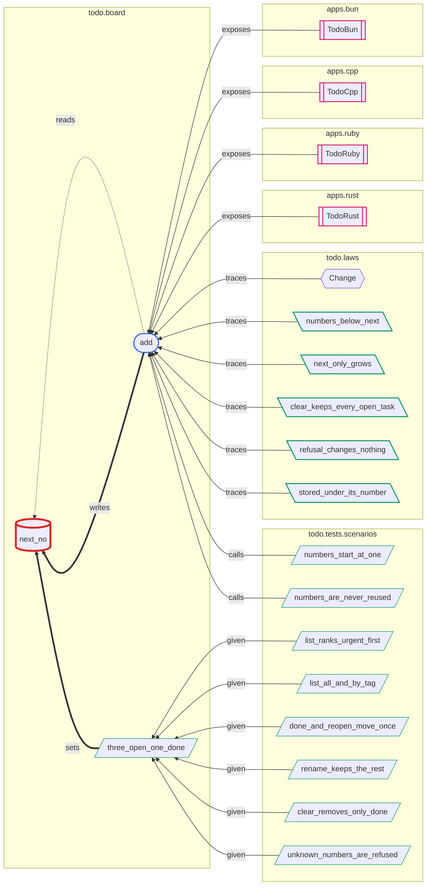

- Tests: `todo.board.three_open_one_done`, `todo.tests.scenarios.numbers_start_at_one`, `todo.tests.scenarios.numbers_are_never_reused`, `todo.tests.scenarios.list_ranks_urgent_first`, `todo.tests.scenarios.list_all_and_by_tag`, `todo.tests.scenarios.done_and_reopen_move_once`, `todo.tests.scenarios.rename_keeps_the_rest`, `todo.tests.scenarios.clear_removes_only_done`, `todo.tests.scenarios.unknown_numbers_are_refused`
- Laws: `todo.laws.numbers_below_next`, `todo.laws.next_only_grows`, `todo.laws.clear_keeps_every_open_task`, `todo.laws.refusal_changes_nothing`, `todo.laws.stored_under_its_number`
- `@cases` of: -

## `todo.board.has_tag`

**10 nodes (4 app, 1 fn, 1 law, 1 rule, 3 test), 9 edges (4 calls, 4 exposes, 1 traces).**

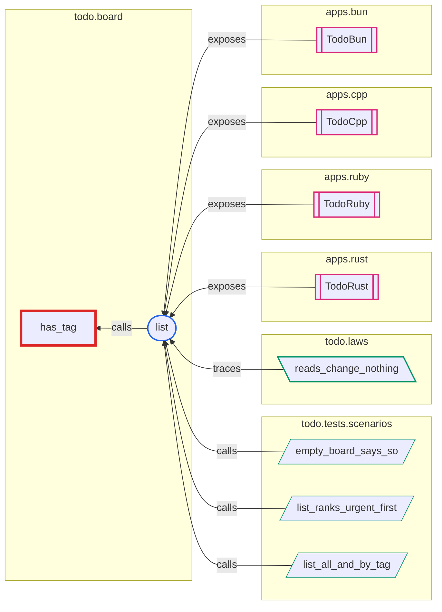

- Tests: `todo.tests.scenarios.empty_board_says_so`, `todo.tests.scenarios.list_ranks_urgent_first`, `todo.tests.scenarios.list_all_and_by_tag`
- Laws: `todo.laws.reads_change_nothing`
- `@cases` of: -

## `todo.board.add`

**13 nodes (4 app, 5 law, 1 rule, 2 test, 1 type), 12 edges (2 calls, 4 exposes, 6 traces).**

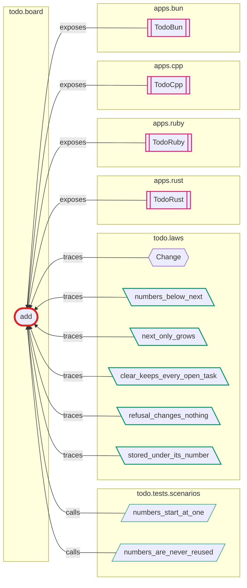

- Tests: `todo.tests.scenarios.numbers_start_at_one`, `todo.tests.scenarios.numbers_are_never_reused`
- Laws: `todo.laws.numbers_below_next`, `todo.laws.next_only_grows`, `todo.laws.clear_keeps_every_open_task`, `todo.laws.refusal_changes_nothing`, `todo.laws.stored_under_its_number`
- `@cases` of: -

## `todo.board.list`

**9 nodes (4 app, 1 law, 1 rule, 3 test), 8 edges (3 calls, 4 exposes, 1 traces).**

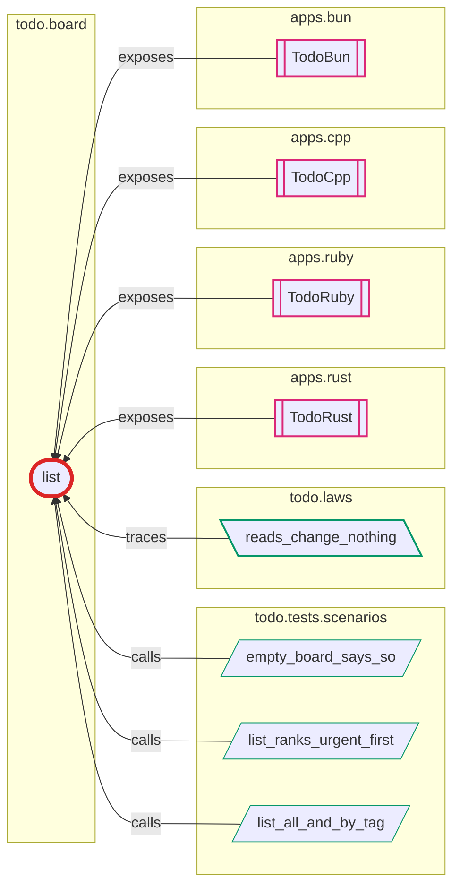

- Tests: `todo.tests.scenarios.empty_board_says_so`, `todo.tests.scenarios.list_ranks_urgent_first`, `todo.tests.scenarios.list_all_and_by_tag`
- Laws: `todo.laws.reads_change_nothing`
- `@cases` of: -

## `todo.board.done`

**13 nodes (4 app, 5 law, 1 rule, 2 test, 1 type), 12 edges (2 calls, 4 exposes, 6 traces).**

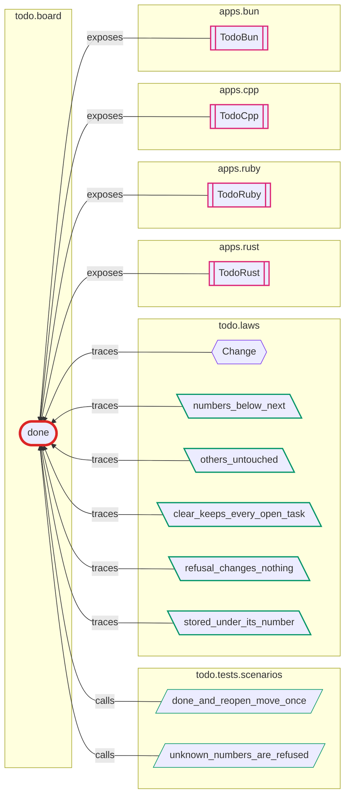

- Tests: `todo.tests.scenarios.done_and_reopen_move_once`, `todo.tests.scenarios.unknown_numbers_are_refused`
- Laws: `todo.laws.numbers_below_next`, `todo.laws.others_untouched`, `todo.laws.clear_keeps_every_open_task`, `todo.laws.refusal_changes_nothing`, `todo.laws.stored_under_its_number`
- `@cases` of: -

## `todo.board.reopen`

**13 nodes (4 app, 5 law, 1 rule, 2 test, 1 type), 12 edges (2 calls, 4 exposes, 6 traces).**


- Tests: `todo.tests.scenarios.done_and_reopen_move_once`, `todo.tests.scenarios.unknown_numbers_are_refused`
- Laws: `todo.laws.numbers_below_next`, `todo.laws.others_untouched`, `todo.laws.clear_keeps_every_open_task`, `todo.laws.refusal_changes_nothing`, `todo.laws.stored_under_its_number`
- `@cases` of: -

## `todo.board.rename`

**13 nodes (4 app, 5 law, 1 rule, 2 test, 1 type), 12 edges (2 calls, 4 exposes, 6 traces).**

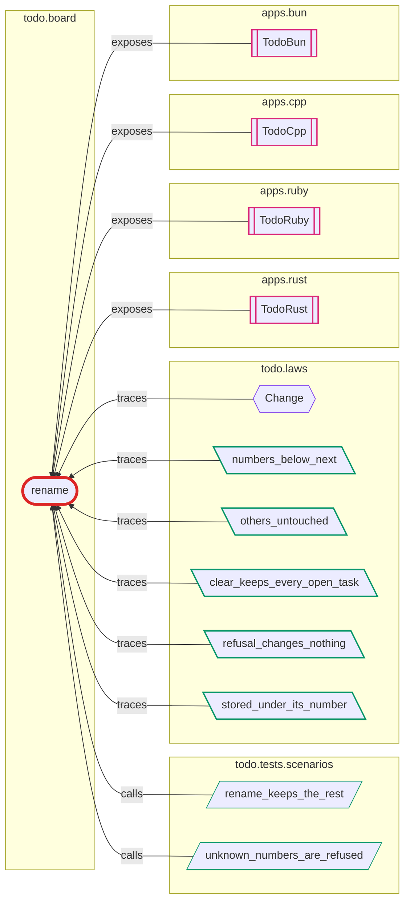

- Tests: `todo.tests.scenarios.rename_keeps_the_rest`, `todo.tests.scenarios.unknown_numbers_are_refused`
- Laws: `todo.laws.numbers_below_next`, `todo.laws.others_untouched`, `todo.laws.clear_keeps_every_open_task`, `todo.laws.refusal_changes_nothing`, `todo.laws.stored_under_its_number`
- `@cases` of: -

## `todo.board.remove`

**13 nodes (4 app, 5 law, 1 rule, 2 test, 1 type), 12 edges (2 calls, 4 exposes, 6 traces).**

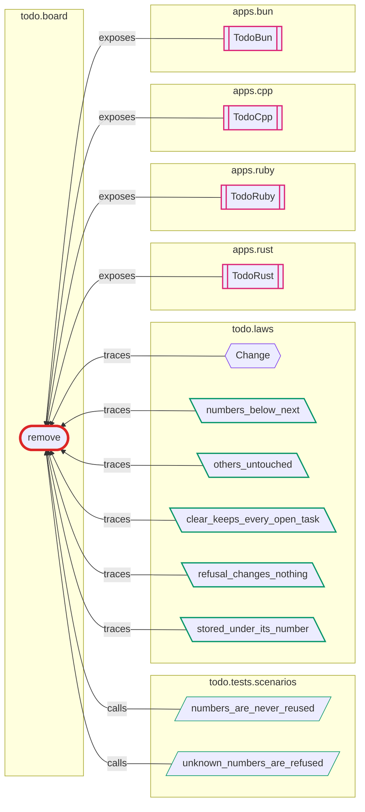

- Tests: `todo.tests.scenarios.numbers_are_never_reused`, `todo.tests.scenarios.unknown_numbers_are_refused`
- Laws: `todo.laws.numbers_below_next`, `todo.laws.others_untouched`, `todo.laws.clear_keeps_every_open_task`, `todo.laws.refusal_changes_nothing`, `todo.laws.stored_under_its_number`
- `@cases` of: -

## `todo.board.clear`

**11 nodes (4 app, 4 law, 1 rule, 1 test, 1 type), 11 edges (1 calls, 4 exposes, 1 matches, 5 traces).**

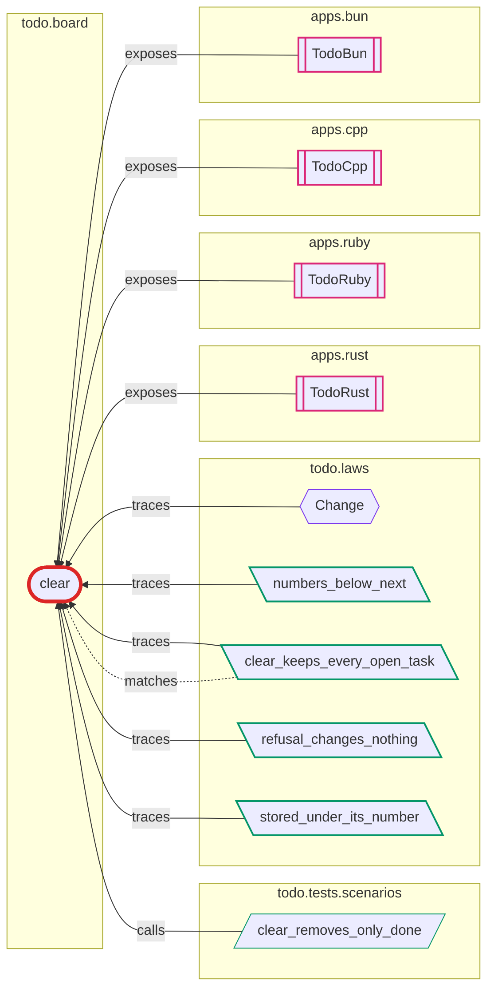

- Tests: `todo.tests.scenarios.clear_removes_only_done`
- Laws: `todo.laws.numbers_below_next`, `todo.laws.clear_keeps_every_open_task`, `todo.laws.refusal_changes_nothing`, `todo.laws.stored_under_its_number`
- `@cases` of: -

## `todo.board.stats`

**8 nodes (4 app, 1 law, 1 rule, 2 test), 7 edges (2 calls, 4 exposes, 1 traces).**

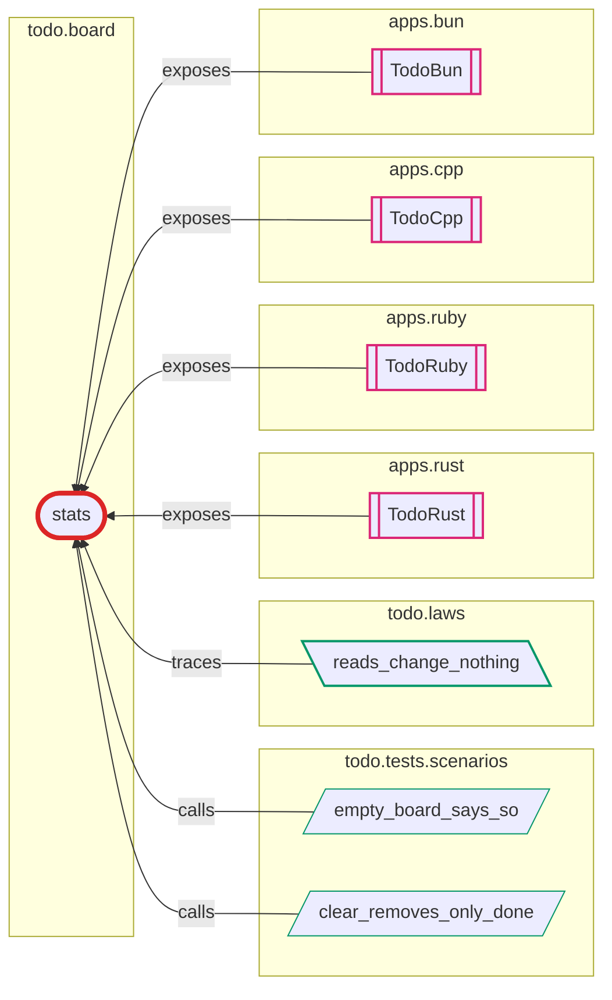

- Tests: `todo.tests.scenarios.empty_board_says_so`, `todo.tests.scenarios.clear_removes_only_done`
- Laws: `todo.laws.reads_change_nothing`
- `@cases` of: -

## `todo.board.three_open_one_done`

**7 nodes (7 test), 6 edges (6 given).**

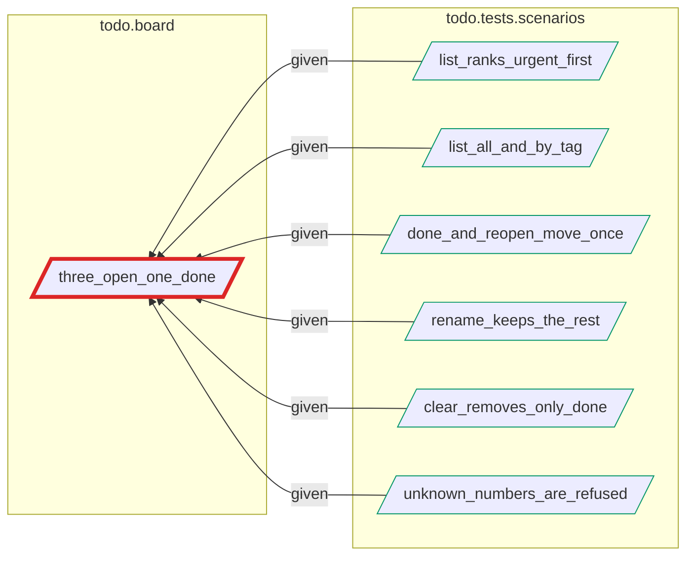

- Tests: `todo.tests.scenarios.list_ranks_urgent_first`, `todo.tests.scenarios.list_all_and_by_tag`, `todo.tests.scenarios.done_and_reopen_move_once`, `todo.tests.scenarios.rename_keeps_the_rest`, `todo.tests.scenarios.clear_removes_only_done`, `todo.tests.scenarios.unknown_numbers_are_refused`
- Laws: -
- `@cases` of: -

## `todo.model.is_title`

**37 nodes (4 app, 4 fn, 7 law, 8 rule, 1 state, 10 test, 3 type), 58 edges (12 calls, 2 constructs, 8 exposes, 4 given, 7 reads, 14 traces, 7 uses, 4 writes).**

```mermaid
flowchart RL
  subgraph g_apps_bun["apps.bun"]
    apps_bun_TodoBun[["TodoBun"]]
  end
  subgraph g_apps_cpp["apps.cpp"]
    apps_cpp_TodoCpp[["TodoCpp"]]
  end
  subgraph g_apps_ruby["apps.ruby"]
    apps_ruby_TodoRuby[["TodoRuby"]]
  end
  subgraph g_apps_rust["apps.rust"]
    apps_rust_TodoRust[["TodoRust"]]
  end
  subgraph g_todo_board["todo.board"]
    todo_board_tasks[("tasks")]
    todo_board_has_tag["has_tag"]
    todo_board_add(["add"])
    todo_board_list(["list"])
    todo_board_done(["done"])
    todo_board_reopen(["reopen"])
    todo_board_rename(["rename"])
    todo_board_remove(["remove"])
    todo_board_clear(["clear"])
    todo_board_stats(["stats"])
    todo_board_three_open_one_done[/"three_open_one_done"/]
  end
  subgraph g_todo_laws["todo.laws"]
    todo_laws_Change{{"Change"}}
    todo_laws_numbers_below_next[\"numbers_below_next"\]
    todo_laws_next_only_grows[\"next_only_grows"\]
    todo_laws_others_untouched[\"others_untouched"\]
    todo_laws_clear_keeps_every_open_task[\"clear_keeps_every_open_task"\]
    todo_laws_reads_change_nothing[\"reads_change_nothing"\]
    todo_laws_refusal_changes_nothing[\"refusal_changes_nothing"\]
    todo_laws_stored_under_its_number[\"stored_under_its_number"\]
  end
  subgraph g_todo_model["todo.model"]
    todo_model_is_title["is_title"]
    todo_model_Title{{"Title"}}
    todo_model_Task{{"Task"}}
  end
  subgraph g_todo_render["todo.render"]
    todo_render_rank["rank"]
    todo_render_line["line"]
  end
  subgraph g_todo_tests_scenarios["todo.tests.scenarios"]
    todo_tests_scenarios_numbers_start_at_one[/"numbers_start_at_one"/]
    todo_tests_scenarios_numbers_are_never_reused[/"numbers_are_never_reused"/]
    todo_tests_scenarios_empty_board_says_so[/"empty_board_says_so"/]
    todo_tests_scenarios_list_ranks_urgent_first[/"list_ranks_urgent_first"/]
    todo_tests_scenarios_list_all_and_by_tag[/"list_all_and_by_tag"/]
    todo_tests_scenarios_done_and_reopen_move_once[/"done_and_reopen_move_once"/]
    todo_tests_scenarios_rename_keeps_the_rest[/"rename_keeps_the_rest"/]
    todo_tests_scenarios_clear_removes_only_done[/"clear_removes_only_done"/]
    todo_tests_scenarios_unknown_numbers_are_refused[/"unknown_numbers_are_refused"/]
  end
  apps_bun_TodoBun -->|"exposes"| todo_board_add
  apps_bun_TodoBun -->|"exposes"| todo_board_rename
  apps_cpp_TodoCpp -->|"exposes"| todo_board_add
  apps_cpp_TodoCpp -->|"exposes"| todo_board_rename
  apps_ruby_TodoRuby -->|"exposes"| todo_board_add
  apps_ruby_TodoRuby -->|"exposes"| todo_board_rename
  apps_rust_TodoRust -->|"exposes"| todo_board_add
  apps_rust_TodoRust -->|"exposes"| todo_board_rename
  todo_board_tasks -.->|"uses"| todo_model_Task
  todo_board_has_tag -.->|"uses"| todo_model_Task
  todo_board_add -.->|"uses"| todo_model_Title
  todo_board_list -.->|"reads"| todo_board_tasks
  todo_board_list -->|"calls"| todo_board_has_tag
  todo_board_list -->|"calls"| todo_render_rank
  todo_board_list -->|"calls"| todo_render_line
  todo_board_done -.->|"reads"| todo_board_tasks
  todo_board_done ==>|"writes"| todo_board_tasks
  todo_board_done -->|"calls"| todo_render_line
  todo_board_reopen -.->|"reads"| todo_board_tasks
  todo_board_reopen ==>|"writes"| todo_board_tasks
  todo_board_reopen -->|"calls"| todo_render_line
  todo_board_rename -.->|"uses"| todo_model_Title
  todo_board_remove -.->|"reads"| todo_board_tasks
  todo_board_remove ==>|"writes"| todo_board_tasks
  todo_board_clear -.->|"reads"| todo_board_tasks
  todo_board_clear ==>|"writes"| todo_board_tasks
  todo_board_stats -.->|"reads"| todo_board_tasks
  todo_board_three_open_one_done --o|"constructs"| todo_model_Task
  todo_laws_Change -->|"traces"| todo_board_add
  todo_laws_Change -->|"traces"| todo_board_rename
  todo_laws_numbers_below_next -->|"traces"| todo_board_add
  todo_laws_numbers_below_next -->|"traces"| todo_board_rename
  todo_laws_next_only_grows -->|"traces"| todo_board_add
  todo_laws_others_untouched -->|"traces"| todo_board_rename
  todo_laws_clear_keeps_every_open_task -->|"traces"| todo_board_add
  todo_laws_clear_keeps_every_open_task -->|"traces"| todo_board_rename
  todo_laws_reads_change_nothing -->|"traces"| todo_board_list
  todo_laws_reads_change_nothing -->|"traces"| todo_board_stats
  todo_laws_refusal_changes_nothing -->|"traces"| todo_board_add
  todo_laws_refusal_changes_nothing -->|"traces"| todo_board_rename
  todo_laws_stored_under_its_number -->|"traces"| todo_board_add
  todo_laws_stored_under_its_number -->|"traces"| todo_board_rename
  todo_model_Title -->|"calls"| todo_model_is_title
  todo_model_Task -.->|"uses"| todo_model_Title
  todo_render_rank -.->|"uses"| todo_model_Task
  todo_render_line -.->|"uses"| todo_model_Task
  todo_tests_scenarios_numbers_start_at_one -->|"calls"| todo_board_add
  todo_tests_scenarios_numbers_are_never_reused -->|"calls"| todo_board_add
  todo_tests_scenarios_empty_board_says_so -->|"calls"| todo_board_list
  todo_tests_scenarios_empty_board_says_so -->|"calls"| todo_board_stats
  todo_tests_scenarios_list_ranks_urgent_first -->|"given"| todo_board_three_open_one_done
  todo_tests_scenarios_list_all_and_by_tag -->|"given"| todo_board_three_open_one_done
  todo_tests_scenarios_done_and_reopen_move_once -->|"given"| todo_board_three_open_one_done
  todo_tests_scenarios_rename_keeps_the_rest -->|"calls"| todo_board_rename
  todo_tests_scenarios_rename_keeps_the_rest --o|"constructs"| todo_model_Task
  todo_tests_scenarios_clear_removes_only_done -->|"given"| todo_board_three_open_one_done
  todo_tests_scenarios_clear_removes_only_done -.->|"reads"| todo_board_tasks
  todo_tests_scenarios_unknown_numbers_are_refused -->|"calls"| todo_board_rename
  classDef app stroke:#db2777,stroke-width:2px
  class apps_bun_TodoBun,apps_cpp_TodoCpp,apps_ruby_TodoRuby,apps_rust_TodoRust app
  classDef law stroke:#059669,stroke-width:2px
  class todo_laws_numbers_below_next,todo_laws_next_only_grows,todo_laws_others_untouched,todo_laws_clear_keeps_every_open_task,todo_laws_reads_change_nothing,todo_laws_refusal_changes_nothing,todo_laws_stored_under_its_number law
  classDef rule stroke:#2563eb,stroke-width:2px
  class todo_board_add,todo_board_list,todo_board_done,todo_board_reopen,todo_board_rename,todo_board_remove,todo_board_clear,todo_board_stats rule
  classDef state stroke:#d97706,stroke-width:2px
  class todo_board_tasks state
  classDef test stroke:#059669,stroke-width:1px
  class todo_board_three_open_one_done,todo_tests_scenarios_numbers_start_at_one,todo_tests_scenarios_numbers_are_never_reused,todo_tests_scenarios_empty_board_says_so,todo_tests_scenarios_list_ranks_urgent_first,todo_tests_scenarios_list_all_and_by_tag,todo_tests_scenarios_done_and_reopen_move_once,todo_tests_scenarios_rename_keeps_the_rest,todo_tests_scenarios_clear_removes_only_done,todo_tests_scenarios_unknown_numbers_are_refused test
  classDef type stroke:#7c3aed,stroke-width:1px
  class todo_laws_Change,todo_model_Title,todo_model_Task type
  classDef hot stroke:#dc2626,stroke-width:4px
  class todo_model_is_title hot
```

- Tests: `todo.board.three_open_one_done`, `todo.tests.scenarios.numbers_start_at_one`, `todo.tests.scenarios.numbers_are_never_reused`, `todo.tests.scenarios.empty_board_says_so`, `todo.tests.scenarios.list_ranks_urgent_first`, `todo.tests.scenarios.list_all_and_by_tag`, `todo.tests.scenarios.done_and_reopen_move_once`, `todo.tests.scenarios.rename_keeps_the_rest`, `todo.tests.scenarios.clear_removes_only_done`, `todo.tests.scenarios.unknown_numbers_are_refused`
- Laws: `todo.laws.numbers_below_next`, `todo.laws.next_only_grows`, `todo.laws.others_untouched`, `todo.laws.clear_keeps_every_open_task`, `todo.laws.reads_change_nothing`, `todo.laws.refusal_changes_nothing`, `todo.laws.stored_under_its_number`
- `@cases` of: `todo.model.is_title`, `todo.render.line`

## `todo.model.is_tag`

**38 nodes (4 app, 5 fn, 7 law, 8 rule, 1 state, 10 test, 3 type), 54 edges (10 calls, 2 constructs, 8 exposes, 3 given, 7 reads, 11 traces, 8 uses, 5 writes).**

```mermaid
flowchart RL
  subgraph g_apps_bun["apps.bun"]
    apps_bun_TodoBun[["TodoBun"]]
  end
  subgraph g_apps_cpp["apps.cpp"]
    apps_cpp_TodoCpp[["TodoCpp"]]
  end
  subgraph g_apps_ruby["apps.ruby"]
    apps_ruby_TodoRuby[["TodoRuby"]]
  end
  subgraph g_apps_rust["apps.rust"]
    apps_rust_TodoRust[["TodoRust"]]
  end
  subgraph g_todo_board["todo.board"]
    todo_board_tasks[("tasks")]
    todo_board_has_tag["has_tag"]
    todo_board_add(["add"])
    todo_board_list(["list"])
    todo_board_done(["done"])
    todo_board_reopen(["reopen"])
    todo_board_rename(["rename"])
    todo_board_remove(["remove"])
    todo_board_clear(["clear"])
    todo_board_stats(["stats"])
    todo_board_three_open_one_done[/"three_open_one_done"/]
  end
  subgraph g_todo_laws["todo.laws"]
    todo_laws_Change{{"Change"}}
    todo_laws_numbers_below_next[\"numbers_below_next"\]
    todo_laws_next_only_grows[\"next_only_grows"\]
    todo_laws_others_untouched[\"others_untouched"\]
    todo_laws_clear_keeps_every_open_task[\"clear_keeps_every_open_task"\]
    todo_laws_reads_change_nothing[\"reads_change_nothing"\]
    todo_laws_refusal_changes_nothing[\"refusal_changes_nothing"\]
    todo_laws_stored_under_its_number[\"stored_under_its_number"\]
  end
  subgraph g_todo_model["todo.model"]
    todo_model_is_tag["is_tag"]
    todo_model_Tag{{"Tag"}}
    todo_model_Task{{"Task"}}
  end
  subgraph g_todo_render["todo.render"]
    todo_render_tag_text["tag_text"]
    todo_render_rank["rank"]
    todo_render_line["line"]
  end
  subgraph g_todo_tests_scenarios["todo.tests.scenarios"]
    todo_tests_scenarios_numbers_start_at_one[/"numbers_start_at_one"/]
    todo_tests_scenarios_numbers_are_never_reused[/"numbers_are_never_reused"/]
    todo_tests_scenarios_empty_board_says_so[/"empty_board_says_so"/]
    todo_tests_scenarios_list_ranks_urgent_first[/"list_ranks_urgent_first"/]
    todo_tests_scenarios_list_all_and_by_tag[/"list_all_and_by_tag"/]
    todo_tests_scenarios_done_and_reopen_move_once[/"done_and_reopen_move_once"/]
    todo_tests_scenarios_rename_keeps_the_rest[/"rename_keeps_the_rest"/]
    todo_tests_scenarios_clear_removes_only_done[/"clear_removes_only_done"/]
    todo_tests_scenarios_unknown_numbers_are_refused[/"unknown_numbers_are_refused"/]
  end
  apps_bun_TodoBun -->|"exposes"| todo_board_add
  apps_bun_TodoBun -->|"exposes"| todo_board_list
  apps_cpp_TodoCpp -->|"exposes"| todo_board_add
  apps_cpp_TodoCpp -->|"exposes"| todo_board_list
  apps_ruby_TodoRuby -->|"exposes"| todo_board_add
  apps_ruby_TodoRuby -->|"exposes"| todo_board_list
  apps_rust_TodoRust -->|"exposes"| todo_board_add
  apps_rust_TodoRust -->|"exposes"| todo_board_list
  todo_board_tasks -.->|"uses"| todo_model_Task
  todo_board_has_tag -.->|"uses"| todo_model_Tag
  todo_board_add -.->|"uses"| todo_model_Tag
  todo_board_list -.->|"uses"| todo_model_Tag
  todo_board_done -.->|"reads"| todo_board_tasks
  todo_board_done ==>|"writes"| todo_board_tasks
  todo_board_done -->|"calls"| todo_render_line
  todo_board_reopen -.->|"reads"| todo_board_tasks
  todo_board_reopen ==>|"writes"| todo_board_tasks
  todo_board_reopen -->|"calls"| todo_render_line
  todo_board_rename -.->|"reads"| todo_board_tasks
  todo_board_rename ==>|"writes"| todo_board_tasks
  todo_board_rename -->|"calls"| todo_render_line
  todo_board_remove -.->|"reads"| todo_board_tasks
  todo_board_remove ==>|"writes"| todo_board_tasks
  todo_board_clear -.->|"reads"| todo_board_tasks
  todo_board_clear ==>|"writes"| todo_board_tasks
  todo_board_stats -.->|"reads"| todo_board_tasks
  todo_board_three_open_one_done --o|"constructs"| todo_model_Task
  todo_laws_Change -->|"traces"| todo_board_add
  todo_laws_numbers_below_next -->|"traces"| todo_board_add
  todo_laws_next_only_grows -->|"traces"| todo_board_add
  todo_laws_others_untouched -->|"traces"| todo_board_done
  todo_laws_others_untouched -->|"traces"| todo_board_reopen
  todo_laws_others_untouched -->|"traces"| todo_board_rename
  todo_laws_others_untouched -->|"traces"| todo_board_remove
  todo_laws_clear_keeps_every_open_task -->|"traces"| todo_board_add
  todo_laws_reads_change_nothing -->|"traces"| todo_board_list
  todo_laws_refusal_changes_nothing -->|"traces"| todo_board_add
  todo_laws_stored_under_its_number -->|"traces"| todo_board_add
  todo_model_Tag -->|"calls"| todo_model_is_tag
  todo_model_Task -.->|"uses"| todo_model_Tag
  todo_render_tag_text -.->|"uses"| todo_model_Tag
  todo_render_rank -.->|"uses"| todo_model_Task
  todo_render_line -.->|"uses"| todo_model_Task
  todo_render_line -->|"calls"| todo_render_tag_text
  todo_tests_scenarios_numbers_start_at_one -->|"calls"| todo_board_add
  todo_tests_scenarios_numbers_are_never_reused -->|"calls"| todo_board_add
  todo_tests_scenarios_empty_board_says_so -->|"calls"| todo_board_list
  todo_tests_scenarios_list_ranks_urgent_first -->|"calls"| todo_board_list
  todo_tests_scenarios_list_all_and_by_tag -->|"calls"| todo_board_list
  todo_tests_scenarios_done_and_reopen_move_once -->|"given"| todo_board_three_open_one_done
  todo_tests_scenarios_rename_keeps_the_rest --o|"constructs"| todo_model_Task
  todo_tests_scenarios_clear_removes_only_done -->|"given"| todo_board_three_open_one_done
  todo_tests_scenarios_clear_removes_only_done -.->|"reads"| todo_board_tasks
  todo_tests_scenarios_unknown_numbers_are_refused -->|"given"| todo_board_three_open_one_done
  classDef app stroke:#db2777,stroke-width:2px
  class apps_bun_TodoBun,apps_cpp_TodoCpp,apps_ruby_TodoRuby,apps_rust_TodoRust app
  classDef law stroke:#059669,stroke-width:2px
  class todo_laws_numbers_below_next,todo_laws_next_only_grows,todo_laws_others_untouched,todo_laws_clear_keeps_every_open_task,todo_laws_reads_change_nothing,todo_laws_refusal_changes_nothing,todo_laws_stored_under_its_number law
  classDef rule stroke:#2563eb,stroke-width:2px
  class todo_board_add,todo_board_list,todo_board_done,todo_board_reopen,todo_board_rename,todo_board_remove,todo_board_clear,todo_board_stats rule
  classDef state stroke:#d97706,stroke-width:2px
  class todo_board_tasks state
  classDef test stroke:#059669,stroke-width:1px
  class todo_board_three_open_one_done,todo_tests_scenarios_numbers_start_at_one,todo_tests_scenarios_numbers_are_never_reused,todo_tests_scenarios_empty_board_says_so,todo_tests_scenarios_list_ranks_urgent_first,todo_tests_scenarios_list_all_and_by_tag,todo_tests_scenarios_done_and_reopen_move_once,todo_tests_scenarios_rename_keeps_the_rest,todo_tests_scenarios_clear_removes_only_done,todo_tests_scenarios_unknown_numbers_are_refused test
  classDef type stroke:#7c3aed,stroke-width:1px
  class todo_laws_Change,todo_model_Tag,todo_model_Task type
  classDef hot stroke:#dc2626,stroke-width:4px
  class todo_model_is_tag hot
```

- Tests: `todo.board.three_open_one_done`, `todo.tests.scenarios.numbers_start_at_one`, `todo.tests.scenarios.numbers_are_never_reused`, `todo.tests.scenarios.empty_board_says_so`, `todo.tests.scenarios.list_ranks_urgent_first`, `todo.tests.scenarios.list_all_and_by_tag`, `todo.tests.scenarios.done_and_reopen_move_once`, `todo.tests.scenarios.rename_keeps_the_rest`, `todo.tests.scenarios.clear_removes_only_done`, `todo.tests.scenarios.unknown_numbers_are_refused`
- Laws: `todo.laws.numbers_below_next`, `todo.laws.next_only_grows`, `todo.laws.others_untouched`, `todo.laws.clear_keeps_every_open_task`, `todo.laws.reads_change_nothing`, `todo.laws.refusal_changes_nothing`, `todo.laws.stored_under_its_number`
- `@cases` of: `todo.model.is_tag`, `todo.render.tag_text`, `todo.render.line`

## `todo.model.Title`

**36 nodes (4 app, 3 fn, 7 law, 8 rule, 1 state, 10 test, 3 type), 57 edges (11 calls, 2 constructs, 8 exposes, 4 given, 7 reads, 14 traces, 7 uses, 4 writes).**

```mermaid
flowchart RL
  subgraph g_apps_bun["apps.bun"]
    apps_bun_TodoBun[["TodoBun"]]
  end
  subgraph g_apps_cpp["apps.cpp"]
    apps_cpp_TodoCpp[["TodoCpp"]]
  end
  subgraph g_apps_ruby["apps.ruby"]
    apps_ruby_TodoRuby[["TodoRuby"]]
  end
  subgraph g_apps_rust["apps.rust"]
    apps_rust_TodoRust[["TodoRust"]]
  end
  subgraph g_todo_board["todo.board"]
    todo_board_tasks[("tasks")]
    todo_board_has_tag["has_tag"]
    todo_board_add(["add"])
    todo_board_list(["list"])
    todo_board_done(["done"])
    todo_board_reopen(["reopen"])
    todo_board_rename(["rename"])
    todo_board_remove(["remove"])
    todo_board_clear(["clear"])
    todo_board_stats(["stats"])
    todo_board_three_open_one_done[/"three_open_one_done"/]
  end
  subgraph g_todo_laws["todo.laws"]
    todo_laws_Change{{"Change"}}
    todo_laws_numbers_below_next[\"numbers_below_next"\]
    todo_laws_next_only_grows[\"next_only_grows"\]
    todo_laws_others_untouched[\"others_untouched"\]
    todo_laws_clear_keeps_every_open_task[\"clear_keeps_every_open_task"\]
    todo_laws_reads_change_nothing[\"reads_change_nothing"\]
    todo_laws_refusal_changes_nothing[\"refusal_changes_nothing"\]
    todo_laws_stored_under_its_number[\"stored_under_its_number"\]
  end
  subgraph g_todo_model["todo.model"]
    todo_model_Title{{"Title"}}
    todo_model_Task{{"Task"}}
  end
  subgraph g_todo_render["todo.render"]
    todo_render_rank["rank"]
    todo_render_line["line"]
  end
  subgraph g_todo_tests_scenarios["todo.tests.scenarios"]
    todo_tests_scenarios_numbers_start_at_one[/"numbers_start_at_one"/]
    todo_tests_scenarios_numbers_are_never_reused[/"numbers_are_never_reused"/]
    todo_tests_scenarios_empty_board_says_so[/"empty_board_says_so"/]
    todo_tests_scenarios_list_ranks_urgent_first[/"list_ranks_urgent_first"/]
    todo_tests_scenarios_list_all_and_by_tag[/"list_all_and_by_tag"/]
    todo_tests_scenarios_done_and_reopen_move_once[/"done_and_reopen_move_once"/]
    todo_tests_scenarios_rename_keeps_the_rest[/"rename_keeps_the_rest"/]
    todo_tests_scenarios_clear_removes_only_done[/"clear_removes_only_done"/]
    todo_tests_scenarios_unknown_numbers_are_refused[/"unknown_numbers_are_refused"/]
  end
  apps_bun_TodoBun -->|"exposes"| todo_board_add
  apps_bun_TodoBun -->|"exposes"| todo_board_rename
  apps_cpp_TodoCpp -->|"exposes"| todo_board_add
  apps_cpp_TodoCpp -->|"exposes"| todo_board_rename
  apps_ruby_TodoRuby -->|"exposes"| todo_board_add
  apps_ruby_TodoRuby -->|"exposes"| todo_board_rename
  apps_rust_TodoRust -->|"exposes"| todo_board_add
  apps_rust_TodoRust -->|"exposes"| todo_board_rename
  todo_board_tasks -.->|"uses"| todo_model_Task
  todo_board_has_tag -.->|"uses"| todo_model_Task
  todo_board_add -.->|"uses"| todo_model_Title
  todo_board_list -.->|"reads"| todo_board_tasks
  todo_board_list -->|"calls"| todo_board_has_tag
  todo_board_list -->|"calls"| todo_render_rank
  todo_board_list -->|"calls"| todo_render_line
  todo_board_done -.->|"reads"| todo_board_tasks
  todo_board_done ==>|"writes"| todo_board_tasks
  todo_board_done -->|"calls"| todo_render_line
  todo_board_reopen -.->|"reads"| todo_board_tasks
  todo_board_reopen ==>|"writes"| todo_board_tasks
  todo_board_reopen -->|"calls"| todo_render_line
  todo_board_rename -.->|"uses"| todo_model_Title
  todo_board_remove -.->|"reads"| todo_board_tasks
  todo_board_remove ==>|"writes"| todo_board_tasks
  todo_board_clear -.->|"reads"| todo_board_tasks
  todo_board_clear ==>|"writes"| todo_board_tasks
  todo_board_stats -.->|"reads"| todo_board_tasks
  todo_board_three_open_one_done --o|"constructs"| todo_model_Task
  todo_laws_Change -->|"traces"| todo_board_add
  todo_laws_Change -->|"traces"| todo_board_rename
  todo_laws_numbers_below_next -->|"traces"| todo_board_add
  todo_laws_numbers_below_next -->|"traces"| todo_board_rename
  todo_laws_next_only_grows -->|"traces"| todo_board_add
  todo_laws_others_untouched -->|"traces"| todo_board_rename
  todo_laws_clear_keeps_every_open_task -->|"traces"| todo_board_add
  todo_laws_clear_keeps_every_open_task -->|"traces"| todo_board_rename
  todo_laws_reads_change_nothing -->|"traces"| todo_board_list
  todo_laws_reads_change_nothing -->|"traces"| todo_board_stats
  todo_laws_refusal_changes_nothing -->|"traces"| todo_board_add
  todo_laws_refusal_changes_nothing -->|"traces"| todo_board_rename
  todo_laws_stored_under_its_number -->|"traces"| todo_board_add
  todo_laws_stored_under_its_number -->|"traces"| todo_board_rename
  todo_model_Task -.->|"uses"| todo_model_Title
  todo_render_rank -.->|"uses"| todo_model_Task
  todo_render_line -.->|"uses"| todo_model_Task
  todo_tests_scenarios_numbers_start_at_one -->|"calls"| todo_board_add
  todo_tests_scenarios_numbers_are_never_reused -->|"calls"| todo_board_add
  todo_tests_scenarios_empty_board_says_so -->|"calls"| todo_board_list
  todo_tests_scenarios_empty_board_says_so -->|"calls"| todo_board_stats
  todo_tests_scenarios_list_ranks_urgent_first -->|"given"| todo_board_three_open_one_done
  todo_tests_scenarios_list_all_and_by_tag -->|"given"| todo_board_three_open_one_done
  todo_tests_scenarios_done_and_reopen_move_once -->|"given"| todo_board_three_open_one_done
  todo_tests_scenarios_rename_keeps_the_rest -->|"calls"| todo_board_rename
  todo_tests_scenarios_rename_keeps_the_rest --o|"constructs"| todo_model_Task
  todo_tests_scenarios_clear_removes_only_done -->|"given"| todo_board_three_open_one_done
  todo_tests_scenarios_clear_removes_only_done -.->|"reads"| todo_board_tasks
  todo_tests_scenarios_unknown_numbers_are_refused -->|"calls"| todo_board_rename
  classDef app stroke:#db2777,stroke-width:2px
  class apps_bun_TodoBun,apps_cpp_TodoCpp,apps_ruby_TodoRuby,apps_rust_TodoRust app
  classDef law stroke:#059669,stroke-width:2px
  class todo_laws_numbers_below_next,todo_laws_next_only_grows,todo_laws_others_untouched,todo_laws_clear_keeps_every_open_task,todo_laws_reads_change_nothing,todo_laws_refusal_changes_nothing,todo_laws_stored_under_its_number law
  classDef rule stroke:#2563eb,stroke-width:2px
  class todo_board_add,todo_board_list,todo_board_done,todo_board_reopen,todo_board_rename,todo_board_remove,todo_board_clear,todo_board_stats rule
  classDef state stroke:#d97706,stroke-width:2px
  class todo_board_tasks state
  classDef test stroke:#059669,stroke-width:1px
  class todo_board_three_open_one_done,todo_tests_scenarios_numbers_start_at_one,todo_tests_scenarios_numbers_are_never_reused,todo_tests_scenarios_empty_board_says_so,todo_tests_scenarios_list_ranks_urgent_first,todo_tests_scenarios_list_all_and_by_tag,todo_tests_scenarios_done_and_reopen_move_once,todo_tests_scenarios_rename_keeps_the_rest,todo_tests_scenarios_clear_removes_only_done,todo_tests_scenarios_unknown_numbers_are_refused test
  classDef type stroke:#7c3aed,stroke-width:1px
  class todo_laws_Change,todo_model_Title,todo_model_Task type
  classDef hot stroke:#dc2626,stroke-width:4px
  class todo_model_Title hot
```

- Tests: `todo.board.three_open_one_done`, `todo.tests.scenarios.numbers_start_at_one`, `todo.tests.scenarios.numbers_are_never_reused`, `todo.tests.scenarios.empty_board_says_so`, `todo.tests.scenarios.list_ranks_urgent_first`, `todo.tests.scenarios.list_all_and_by_tag`, `todo.tests.scenarios.done_and_reopen_move_once`, `todo.tests.scenarios.rename_keeps_the_rest`, `todo.tests.scenarios.clear_removes_only_done`, `todo.tests.scenarios.unknown_numbers_are_refused`
- Laws: `todo.laws.numbers_below_next`, `todo.laws.next_only_grows`, `todo.laws.others_untouched`, `todo.laws.clear_keeps_every_open_task`, `todo.laws.reads_change_nothing`, `todo.laws.refusal_changes_nothing`, `todo.laws.stored_under_its_number`
- `@cases` of: `todo.render.line`

## `todo.model.Tag`

**37 nodes (4 app, 4 fn, 7 law, 8 rule, 1 state, 10 test, 3 type), 53 edges (9 calls, 2 constructs, 8 exposes, 3 given, 7 reads, 11 traces, 8 uses, 5 writes).**

```mermaid
flowchart RL
  subgraph g_apps_bun["apps.bun"]
    apps_bun_TodoBun[["TodoBun"]]
  end
  subgraph g_apps_cpp["apps.cpp"]
    apps_cpp_TodoCpp[["TodoCpp"]]
  end
  subgraph g_apps_ruby["apps.ruby"]
    apps_ruby_TodoRuby[["TodoRuby"]]
  end
  subgraph g_apps_rust["apps.rust"]
    apps_rust_TodoRust[["TodoRust"]]
  end
  subgraph g_todo_board["todo.board"]
    todo_board_tasks[("tasks")]
    todo_board_has_tag["has_tag"]
    todo_board_add(["add"])
    todo_board_list(["list"])
    todo_board_done(["done"])
    todo_board_reopen(["reopen"])
    todo_board_rename(["rename"])
    todo_board_remove(["remove"])
    todo_board_clear(["clear"])
    todo_board_stats(["stats"])
    todo_board_three_open_one_done[/"three_open_one_done"/]
  end
  subgraph g_todo_laws["todo.laws"]
    todo_laws_Change{{"Change"}}
    todo_laws_numbers_below_next[\"numbers_below_next"\]
    todo_laws_next_only_grows[\"next_only_grows"\]
    todo_laws_others_untouched[\"others_untouched"\]
    todo_laws_clear_keeps_every_open_task[\"clear_keeps_every_open_task"\]
    todo_laws_reads_change_nothing[\"reads_change_nothing"\]
    todo_laws_refusal_changes_nothing[\"refusal_changes_nothing"\]
    todo_laws_stored_under_its_number[\"stored_under_its_number"\]
  end
  subgraph g_todo_model["todo.model"]
    todo_model_Tag{{"Tag"}}
    todo_model_Task{{"Task"}}
  end
  subgraph g_todo_render["todo.render"]
    todo_render_tag_text["tag_text"]
    todo_render_rank["rank"]
    todo_render_line["line"]
  end
  subgraph g_todo_tests_scenarios["todo.tests.scenarios"]
    todo_tests_scenarios_numbers_start_at_one[/"numbers_start_at_one"/]
    todo_tests_scenarios_numbers_are_never_reused[/"numbers_are_never_reused"/]
    todo_tests_scenarios_empty_board_says_so[/"empty_board_says_so"/]
    todo_tests_scenarios_list_ranks_urgent_first[/"list_ranks_urgent_first"/]
    todo_tests_scenarios_list_all_and_by_tag[/"list_all_and_by_tag"/]
    todo_tests_scenarios_done_and_reopen_move_once[/"done_and_reopen_move_once"/]
    todo_tests_scenarios_rename_keeps_the_rest[/"rename_keeps_the_rest"/]
    todo_tests_scenarios_clear_removes_only_done[/"clear_removes_only_done"/]
    todo_tests_scenarios_unknown_numbers_are_refused[/"unknown_numbers_are_refused"/]
  end
  apps_bun_TodoBun -->|"exposes"| todo_board_add
  apps_bun_TodoBun -->|"exposes"| todo_board_list
  apps_cpp_TodoCpp -->|"exposes"| todo_board_add
  apps_cpp_TodoCpp -->|"exposes"| todo_board_list
  apps_ruby_TodoRuby -->|"exposes"| todo_board_add
  apps_ruby_TodoRuby -->|"exposes"| todo_board_list
  apps_rust_TodoRust -->|"exposes"| todo_board_add
  apps_rust_TodoRust -->|"exposes"| todo_board_list
  todo_board_tasks -.->|"uses"| todo_model_Task
  todo_board_has_tag -.->|"uses"| todo_model_Tag
  todo_board_add -.->|"uses"| todo_model_Tag
  todo_board_list -.->|"uses"| todo_model_Tag
  todo_board_done -.->|"reads"| todo_board_tasks
  todo_board_done ==>|"writes"| todo_board_tasks
  todo_board_done -->|"calls"| todo_render_line
  todo_board_reopen -.->|"reads"| todo_board_tasks
  todo_board_reopen ==>|"writes"| todo_board_tasks
  todo_board_reopen -->|"calls"| todo_render_line
  todo_board_rename -.->|"reads"| todo_board_tasks
  todo_board_rename ==>|"writes"| todo_board_tasks
  todo_board_rename -->|"calls"| todo_render_line
  todo_board_remove -.->|"reads"| todo_board_tasks
  todo_board_remove ==>|"writes"| todo_board_tasks
  todo_board_clear -.->|"reads"| todo_board_tasks
  todo_board_clear ==>|"writes"| todo_board_tasks
  todo_board_stats -.->|"reads"| todo_board_tasks
  todo_board_three_open_one_done --o|"constructs"| todo_model_Task
  todo_laws_Change -->|"traces"| todo_board_add
  todo_laws_numbers_below_next -->|"traces"| todo_board_add
  todo_laws_next_only_grows -->|"traces"| todo_board_add
  todo_laws_others_untouched -->|"traces"| todo_board_done
  todo_laws_others_untouched -->|"traces"| todo_board_reopen
  todo_laws_others_untouched -->|"traces"| todo_board_rename
  todo_laws_others_untouched -->|"traces"| todo_board_remove
  todo_laws_clear_keeps_every_open_task -->|"traces"| todo_board_add
  todo_laws_reads_change_nothing -->|"traces"| todo_board_list
  todo_laws_refusal_changes_nothing -->|"traces"| todo_board_add
  todo_laws_stored_under_its_number -->|"traces"| todo_board_add
  todo_model_Task -.->|"uses"| todo_model_Tag
  todo_render_tag_text -.->|"uses"| todo_model_Tag
  todo_render_rank -.->|"uses"| todo_model_Task
  todo_render_line -.->|"uses"| todo_model_Task
  todo_render_line -->|"calls"| todo_render_tag_text
  todo_tests_scenarios_numbers_start_at_one -->|"calls"| todo_board_add
  todo_tests_scenarios_numbers_are_never_reused -->|"calls"| todo_board_add
  todo_tests_scenarios_empty_board_says_so -->|"calls"| todo_board_list
  todo_tests_scenarios_list_ranks_urgent_first -->|"calls"| todo_board_list
  todo_tests_scenarios_list_all_and_by_tag -->|"calls"| todo_board_list
  todo_tests_scenarios_done_and_reopen_move_once -->|"given"| todo_board_three_open_one_done
  todo_tests_scenarios_rename_keeps_the_rest --o|"constructs"| todo_model_Task
  todo_tests_scenarios_clear_removes_only_done -->|"given"| todo_board_three_open_one_done
  todo_tests_scenarios_clear_removes_only_done -.->|"reads"| todo_board_tasks
  todo_tests_scenarios_unknown_numbers_are_refused -->|"given"| todo_board_three_open_one_done
  classDef app stroke:#db2777,stroke-width:2px
  class apps_bun_TodoBun,apps_cpp_TodoCpp,apps_ruby_TodoRuby,apps_rust_TodoRust app
  classDef law stroke:#059669,stroke-width:2px
  class todo_laws_numbers_below_next,todo_laws_next_only_grows,todo_laws_others_untouched,todo_laws_clear_keeps_every_open_task,todo_laws_reads_change_nothing,todo_laws_refusal_changes_nothing,todo_laws_stored_under_its_number law
  classDef rule stroke:#2563eb,stroke-width:2px
  class todo_board_add,todo_board_list,todo_board_done,todo_board_reopen,todo_board_rename,todo_board_remove,todo_board_clear,todo_board_stats rule
  classDef state stroke:#d97706,stroke-width:2px
  class todo_board_tasks state
  classDef test stroke:#059669,stroke-width:1px
  class todo_board_three_open_one_done,todo_tests_scenarios_numbers_start_at_one,todo_tests_scenarios_numbers_are_never_reused,todo_tests_scenarios_empty_board_says_so,todo_tests_scenarios_list_ranks_urgent_first,todo_tests_scenarios_list_all_and_by_tag,todo_tests_scenarios_done_and_reopen_move_once,todo_tests_scenarios_rename_keeps_the_rest,todo_tests_scenarios_clear_removes_only_done,todo_tests_scenarios_unknown_numbers_are_refused test
  classDef type stroke:#7c3aed,stroke-width:1px
  class todo_laws_Change,todo_model_Tag,todo_model_Task type
  classDef hot stroke:#dc2626,stroke-width:4px
  class todo_model_Tag hot
```

- Tests: `todo.board.three_open_one_done`, `todo.tests.scenarios.numbers_start_at_one`, `todo.tests.scenarios.numbers_are_never_reused`, `todo.tests.scenarios.empty_board_says_so`, `todo.tests.scenarios.list_ranks_urgent_first`, `todo.tests.scenarios.list_all_and_by_tag`, `todo.tests.scenarios.done_and_reopen_move_once`, `todo.tests.scenarios.rename_keeps_the_rest`, `todo.tests.scenarios.clear_removes_only_done`, `todo.tests.scenarios.unknown_numbers_are_refused`
- Laws: `todo.laws.numbers_below_next`, `todo.laws.next_only_grows`, `todo.laws.others_untouched`, `todo.laws.clear_keeps_every_open_task`, `todo.laws.reads_change_nothing`, `todo.laws.refusal_changes_nothing`, `todo.laws.stored_under_its_number`
- `@cases` of: `todo.render.tag_text`, `todo.render.line`

## `todo.model.TaskNo`

**37 nodes (4 app, 3 fn, 7 law, 8 rule, 2 state, 10 test, 3 type), 83 edges (10 calls, 2 constructs, 20 exposes, 2 given, 5 reads, 2 sets, 28 traces, 13 uses, 1 writes).**

```mermaid
flowchart RL
  subgraph g_apps_bun["apps.bun"]
    apps_bun_TodoBun[["TodoBun"]]
  end
  subgraph g_apps_cpp["apps.cpp"]
    apps_cpp_TodoCpp[["TodoCpp"]]
  end
  subgraph g_apps_ruby["apps.ruby"]
    apps_ruby_TodoRuby[["TodoRuby"]]
  end
  subgraph g_apps_rust["apps.rust"]
    apps_rust_TodoRust[["TodoRust"]]
  end
  subgraph g_todo_board["todo.board"]
    todo_board_tasks[("tasks")]
    todo_board_next_no[("next_no")]
    todo_board_has_tag["has_tag"]
    todo_board_add(["add"])
    todo_board_list(["list"])
    todo_board_done(["done"])
    todo_board_reopen(["reopen"])
    todo_board_rename(["rename"])
    todo_board_remove(["remove"])
    todo_board_clear(["clear"])
    todo_board_stats(["stats"])
    todo_board_three_open_one_done[/"three_open_one_done"/]
  end
  subgraph g_todo_laws["todo.laws"]
    todo_laws_Change{{"Change"}}
    todo_laws_numbers_below_next[\"numbers_below_next"\]
    todo_laws_next_only_grows[\"next_only_grows"\]
    todo_laws_others_untouched[\"others_untouched"\]
    todo_laws_clear_keeps_every_open_task[\"clear_keeps_every_open_task"\]
    todo_laws_reads_change_nothing[\"reads_change_nothing"\]
    todo_laws_refusal_changes_nothing[\"refusal_changes_nothing"\]
    todo_laws_stored_under_its_number[\"stored_under_its_number"\]
  end
  subgraph g_todo_model["todo.model"]
    todo_model_TaskNo{{"TaskNo"}}
    todo_model_Task{{"Task"}}
  end
  subgraph g_todo_render["todo.render"]
    todo_render_rank["rank"]
    todo_render_line["line"]
  end
  subgraph g_todo_tests_scenarios["todo.tests.scenarios"]
    todo_tests_scenarios_numbers_start_at_one[/"numbers_start_at_one"/]
    todo_tests_scenarios_numbers_are_never_reused[/"numbers_are_never_reused"/]
    todo_tests_scenarios_empty_board_says_so[/"empty_board_says_so"/]
    todo_tests_scenarios_list_ranks_urgent_first[/"list_ranks_urgent_first"/]
    todo_tests_scenarios_list_all_and_by_tag[/"list_all_and_by_tag"/]
    todo_tests_scenarios_done_and_reopen_move_once[/"done_and_reopen_move_once"/]
    todo_tests_scenarios_rename_keeps_the_rest[/"rename_keeps_the_rest"/]
    todo_tests_scenarios_clear_removes_only_done[/"clear_removes_only_done"/]
    todo_tests_scenarios_unknown_numbers_are_refused[/"unknown_numbers_are_refused"/]
  end
  apps_bun_TodoBun -->|"exposes"| todo_board_add
  apps_bun_TodoBun -->|"exposes"| todo_board_done
  apps_bun_TodoBun -->|"exposes"| todo_board_reopen
  apps_bun_TodoBun -->|"exposes"| todo_board_rename
  apps_bun_TodoBun -->|"exposes"| todo_board_remove
  apps_cpp_TodoCpp -->|"exposes"| todo_board_add
  apps_cpp_TodoCpp -->|"exposes"| todo_board_done
  apps_cpp_TodoCpp -->|"exposes"| todo_board_reopen
  apps_cpp_TodoCpp -->|"exposes"| todo_board_rename
  apps_cpp_TodoCpp -->|"exposes"| todo_board_remove
  apps_ruby_TodoRuby -->|"exposes"| todo_board_add
  apps_ruby_TodoRuby -->|"exposes"| todo_board_done
  apps_ruby_TodoRuby -->|"exposes"| todo_board_reopen
  apps_ruby_TodoRuby -->|"exposes"| todo_board_rename
  apps_ruby_TodoRuby -->|"exposes"| todo_board_remove
  apps_rust_TodoRust -->|"exposes"| todo_board_add
  apps_rust_TodoRust -->|"exposes"| todo_board_done
  apps_rust_TodoRust -->|"exposes"| todo_board_reopen
  apps_rust_TodoRust -->|"exposes"| todo_board_rename
  apps_rust_TodoRust -->|"exposes"| todo_board_remove
  todo_board_tasks -.->|"uses"| todo_model_TaskNo
  todo_board_next_no -.->|"uses"| todo_model_TaskNo
  todo_board_has_tag -.->|"uses"| todo_model_Task
  todo_board_add -.->|"uses"| todo_model_TaskNo
  todo_board_list -.->|"reads"| todo_board_tasks
  todo_board_done -.->|"uses"| todo_model_TaskNo
  todo_board_reopen -.->|"uses"| todo_model_TaskNo
  todo_board_rename -.->|"uses"| todo_model_TaskNo
  todo_board_remove -.->|"uses"| todo_model_TaskNo
  todo_board_clear -.->|"reads"| todo_board_tasks
  todo_board_clear ==>|"writes"| todo_board_tasks
  todo_board_stats -.->|"reads"| todo_board_tasks
  todo_board_three_open_one_done ==>|"sets"| todo_board_tasks
  todo_board_three_open_one_done --o|"constructs"| todo_model_Task
  todo_board_three_open_one_done ==>|"sets"| todo_board_next_no
  todo_laws_Change -->|"traces"| todo_board_add
  todo_laws_Change -->|"traces"| todo_board_done
  todo_laws_Change -->|"traces"| todo_board_reopen
  todo_laws_Change -->|"traces"| todo_board_rename
  todo_laws_Change -->|"traces"| todo_board_remove
  todo_laws_numbers_below_next -->|"traces"| todo_board_add
  todo_laws_numbers_below_next -->|"traces"| todo_board_done
  todo_laws_numbers_below_next -->|"traces"| todo_board_reopen
  todo_laws_numbers_below_next -->|"traces"| todo_board_rename
  todo_laws_numbers_below_next -->|"traces"| todo_board_remove
  todo_laws_next_only_grows -->|"traces"| todo_board_add
  todo_laws_others_untouched -.->|"uses"| todo_model_TaskNo
  todo_laws_clear_keeps_every_open_task -->|"traces"| todo_board_add
  todo_laws_clear_keeps_every_open_task -->|"traces"| todo_board_done
  todo_laws_clear_keeps_every_open_task -->|"traces"| todo_board_reopen
  todo_laws_clear_keeps_every_open_task -->|"traces"| todo_board_rename
  todo_laws_clear_keeps_every_open_task -->|"traces"| todo_board_remove
  todo_laws_reads_change_nothing -->|"traces"| todo_board_list
  todo_laws_reads_change_nothing -->|"traces"| todo_board_stats
  todo_laws_refusal_changes_nothing -->|"traces"| todo_board_add
  todo_laws_refusal_changes_nothing -->|"traces"| todo_board_done
  todo_laws_refusal_changes_nothing -->|"traces"| todo_board_reopen
  todo_laws_refusal_changes_nothing -->|"traces"| todo_board_rename
  todo_laws_refusal_changes_nothing -->|"traces"| todo_board_remove
  todo_laws_stored_under_its_number -->|"traces"| todo_board_add
  todo_laws_stored_under_its_number -->|"traces"| todo_board_done
  todo_laws_stored_under_its_number -->|"traces"| todo_board_reopen
  todo_laws_stored_under_its_number -->|"traces"| todo_board_rename
  todo_laws_stored_under_its_number -->|"traces"| todo_board_remove
  todo_model_Task -.->|"uses"| todo_model_TaskNo
  todo_render_rank -.->|"uses"| todo_model_Task
  todo_render_line -.->|"uses"| todo_model_Task
  todo_tests_scenarios_numbers_start_at_one -->|"calls"| todo_board_add
  todo_tests_scenarios_numbers_are_never_reused -->|"calls"| todo_board_add
  todo_tests_scenarios_numbers_are_never_reused -->|"calls"| todo_board_remove
  todo_tests_scenarios_empty_board_says_so -->|"calls"| todo_board_list
  todo_tests_scenarios_empty_board_says_so -->|"calls"| todo_board_stats
  todo_tests_scenarios_list_ranks_urgent_first -->|"given"| todo_board_three_open_one_done
  todo_tests_scenarios_list_ranks_urgent_first -->|"calls"| todo_board_list
  todo_tests_scenarios_list_all_and_by_tag -->|"given"| todo_board_three_open_one_done
  todo_tests_scenarios_list_all_and_by_tag -->|"calls"| todo_board_list
  todo_tests_scenarios_done_and_reopen_move_once -->|"calls"| todo_board_done
  todo_tests_scenarios_done_and_reopen_move_once -->|"calls"| todo_board_reopen
  todo_tests_scenarios_rename_keeps_the_rest -->|"calls"| todo_board_rename
  todo_tests_scenarios_rename_keeps_the_rest -.->|"reads"| todo_board_tasks
  todo_tests_scenarios_rename_keeps_the_rest --o|"constructs"| todo_model_Task
  todo_tests_scenarios_clear_removes_only_done -.->|"reads"| todo_board_tasks
  todo_tests_scenarios_unknown_numbers_are_refused -.->|"uses"| todo_model_TaskNo
  classDef app stroke:#db2777,stroke-width:2px
  class apps_bun_TodoBun,apps_cpp_TodoCpp,apps_ruby_TodoRuby,apps_rust_TodoRust app
  classDef law stroke:#059669,stroke-width:2px
  class todo_laws_numbers_below_next,todo_laws_next_only_grows,todo_laws_others_untouched,todo_laws_clear_keeps_every_open_task,todo_laws_reads_change_nothing,todo_laws_refusal_changes_nothing,todo_laws_stored_under_its_number law
  classDef rule stroke:#2563eb,stroke-width:2px
  class todo_board_add,todo_board_list,todo_board_done,todo_board_reopen,todo_board_rename,todo_board_remove,todo_board_clear,todo_board_stats rule
  classDef state stroke:#d97706,stroke-width:2px
  class todo_board_tasks,todo_board_next_no state
  classDef test stroke:#059669,stroke-width:1px
  class todo_board_three_open_one_done,todo_tests_scenarios_numbers_start_at_one,todo_tests_scenarios_numbers_are_never_reused,todo_tests_scenarios_empty_board_says_so,todo_tests_scenarios_list_ranks_urgent_first,todo_tests_scenarios_list_all_and_by_tag,todo_tests_scenarios_done_and_reopen_move_once,todo_tests_scenarios_rename_keeps_the_rest,todo_tests_scenarios_clear_removes_only_done,todo_tests_scenarios_unknown_numbers_are_refused test
  classDef type stroke:#7c3aed,stroke-width:1px
  class todo_laws_Change,todo_model_TaskNo,todo_model_Task type
  classDef hot stroke:#dc2626,stroke-width:4px
  class todo_model_TaskNo hot
```

- Tests: `todo.board.three_open_one_done`, `todo.tests.scenarios.numbers_start_at_one`, `todo.tests.scenarios.numbers_are_never_reused`, `todo.tests.scenarios.empty_board_says_so`, `todo.tests.scenarios.list_ranks_urgent_first`, `todo.tests.scenarios.list_all_and_by_tag`, `todo.tests.scenarios.done_and_reopen_move_once`, `todo.tests.scenarios.rename_keeps_the_rest`, `todo.tests.scenarios.clear_removes_only_done`, `todo.tests.scenarios.unknown_numbers_are_refused`
- Laws: `todo.laws.numbers_below_next`, `todo.laws.next_only_grows`, `todo.laws.others_untouched`, `todo.laws.clear_keeps_every_open_task`, `todo.laws.reads_change_nothing`, `todo.laws.refusal_changes_nothing`, `todo.laws.stored_under_its_number`
- `@cases` of: `todo.render.line`

## `todo.model.Status`

**37 nodes (4 app, 4 fn, 7 law, 8 rule, 1 state, 10 test, 3 type), 78 edges (14 calls, 10 constructs, 20 exposes, 6 given, 1 matches, 2 reads, 17 traces, 6 uses, 2 writes).**

```mermaid
flowchart RL
  subgraph g_apps_bun["apps.bun"]
    apps_bun_TodoBun[["TodoBun"]]
  end
  subgraph g_apps_cpp["apps.cpp"]
    apps_cpp_TodoCpp[["TodoCpp"]]
  end
  subgraph g_apps_ruby["apps.ruby"]
    apps_ruby_TodoRuby[["TodoRuby"]]
  end
  subgraph g_apps_rust["apps.rust"]
    apps_rust_TodoRust[["TodoRust"]]
  end
  subgraph g_todo_board["todo.board"]
    todo_board_tasks[("tasks")]
    todo_board_has_tag["has_tag"]
    todo_board_add(["add"])
    todo_board_list(["list"])
    todo_board_done(["done"])
    todo_board_reopen(["reopen"])
    todo_board_rename(["rename"])
    todo_board_remove(["remove"])
    todo_board_clear(["clear"])
    todo_board_stats(["stats"])
    todo_board_three_open_one_done[/"three_open_one_done"/]
  end
  subgraph g_todo_laws["todo.laws"]
    todo_laws_Change{{"Change"}}
    todo_laws_numbers_below_next[\"numbers_below_next"\]
    todo_laws_next_only_grows[\"next_only_grows"\]
    todo_laws_others_untouched[\"others_untouched"\]
    todo_laws_clear_keeps_every_open_task[\"clear_keeps_every_open_task"\]
    todo_laws_reads_change_nothing[\"reads_change_nothing"\]
    todo_laws_refusal_changes_nothing[\"refusal_changes_nothing"\]
    todo_laws_stored_under_its_number[\"stored_under_its_number"\]
  end
  subgraph g_todo_model["todo.model"]
    todo_model_Status{{"Status"}}
    todo_model_Task{{"Task"}}
  end
  subgraph g_todo_render["todo.render"]
    todo_render_mark["mark"]
    todo_render_rank["rank"]
    todo_render_line["line"]
  end
  subgraph g_todo_tests_scenarios["todo.tests.scenarios"]
    todo_tests_scenarios_numbers_start_at_one[/"numbers_start_at_one"/]
    todo_tests_scenarios_numbers_are_never_reused[/"numbers_are_never_reused"/]
    todo_tests_scenarios_empty_board_says_so[/"empty_board_says_so"/]
    todo_tests_scenarios_list_ranks_urgent_first[/"list_ranks_urgent_first"/]
    todo_tests_scenarios_list_all_and_by_tag[/"list_all_and_by_tag"/]
    todo_tests_scenarios_done_and_reopen_move_once[/"done_and_reopen_move_once"/]
    todo_tests_scenarios_rename_keeps_the_rest[/"rename_keeps_the_rest"/]
    todo_tests_scenarios_clear_removes_only_done[/"clear_removes_only_done"/]
    todo_tests_scenarios_unknown_numbers_are_refused[/"unknown_numbers_are_refused"/]
  end
  apps_bun_TodoBun -->|"exposes"| todo_board_list
  apps_bun_TodoBun -->|"exposes"| todo_board_done
  apps_bun_TodoBun -->|"exposes"| todo_board_reopen
  apps_bun_TodoBun -->|"exposes"| todo_board_clear
  apps_bun_TodoBun -->|"exposes"| todo_board_stats
  apps_cpp_TodoCpp -->|"exposes"| todo_board_list
  apps_cpp_TodoCpp -->|"exposes"| todo_board_done
  apps_cpp_TodoCpp -->|"exposes"| todo_board_reopen
  apps_cpp_TodoCpp -->|"exposes"| todo_board_clear
  apps_cpp_TodoCpp -->|"exposes"| todo_board_stats
  apps_ruby_TodoRuby -->|"exposes"| todo_board_list
  apps_ruby_TodoRuby -->|"exposes"| todo_board_done
  apps_ruby_TodoRuby -->|"exposes"| todo_board_reopen
  apps_ruby_TodoRuby -->|"exposes"| todo_board_clear
  apps_ruby_TodoRuby -->|"exposes"| todo_board_stats
  apps_rust_TodoRust -->|"exposes"| todo_board_list
  apps_rust_TodoRust -->|"exposes"| todo_board_done
  apps_rust_TodoRust -->|"exposes"| todo_board_reopen
  apps_rust_TodoRust -->|"exposes"| todo_board_clear
  apps_rust_TodoRust -->|"exposes"| todo_board_stats
  todo_board_tasks -.->|"uses"| todo_model_Task
  todo_board_has_tag -.->|"uses"| todo_model_Task
  todo_board_add --o|"constructs"| todo_model_Task
  todo_board_list --o|"constructs"| todo_model_Status
  todo_board_done --o|"constructs"| todo_model_Status
  todo_board_reopen --o|"constructs"| todo_model_Status
  todo_board_rename -.->|"reads"| todo_board_tasks
  todo_board_rename ==>|"writes"| todo_board_tasks
  todo_board_rename -->|"calls"| todo_render_line
  todo_board_remove -.->|"reads"| todo_board_tasks
  todo_board_remove ==>|"writes"| todo_board_tasks
  todo_board_clear --o|"constructs"| todo_model_Status
  todo_board_stats --o|"constructs"| todo_model_Status
  todo_board_three_open_one_done --o|"constructs"| todo_model_Status
  todo_laws_Change -->|"traces"| todo_board_done
  todo_laws_Change -->|"traces"| todo_board_reopen
  todo_laws_Change -->|"traces"| todo_board_clear
  todo_laws_numbers_below_next -->|"traces"| todo_board_done
  todo_laws_numbers_below_next -->|"traces"| todo_board_reopen
  todo_laws_numbers_below_next -->|"traces"| todo_board_clear
  todo_laws_next_only_grows -->|"traces"| todo_board_add
  todo_laws_others_untouched -->|"traces"| todo_board_done
  todo_laws_others_untouched -->|"traces"| todo_board_reopen
  todo_laws_clear_keeps_every_open_task --o|"constructs"| todo_model_Status
  todo_laws_reads_change_nothing -->|"traces"| todo_board_list
  todo_laws_reads_change_nothing -->|"traces"| todo_board_stats
  todo_laws_refusal_changes_nothing -->|"traces"| todo_board_done
  todo_laws_refusal_changes_nothing -->|"traces"| todo_board_reopen
  todo_laws_refusal_changes_nothing -->|"traces"| todo_board_clear
  todo_laws_stored_under_its_number -->|"traces"| todo_board_done
  todo_laws_stored_under_its_number -->|"traces"| todo_board_reopen
  todo_laws_stored_under_its_number -->|"traces"| todo_board_clear
  todo_model_Task -.->|"uses"| todo_model_Status
  todo_model_Task --o|"constructs"| todo_model_Status
  todo_render_mark -.->|"uses"| todo_model_Status
  todo_render_mark -.->|"matches"| todo_model_Status
  todo_render_rank -.->|"uses"| todo_model_Task
  todo_render_line -.->|"uses"| todo_model_Task
  todo_render_line -->|"calls"| todo_render_mark
  todo_tests_scenarios_numbers_start_at_one -->|"calls"| todo_board_add
  todo_tests_scenarios_numbers_are_never_reused -->|"calls"| todo_board_add
  todo_tests_scenarios_empty_board_says_so -->|"calls"| todo_board_list
  todo_tests_scenarios_empty_board_says_so -->|"calls"| todo_board_stats
  todo_tests_scenarios_list_ranks_urgent_first -->|"given"| todo_board_three_open_one_done
  todo_tests_scenarios_list_ranks_urgent_first -->|"calls"| todo_board_list
  todo_tests_scenarios_list_all_and_by_tag -->|"given"| todo_board_three_open_one_done
  todo_tests_scenarios_list_all_and_by_tag -->|"calls"| todo_board_list
  todo_tests_scenarios_done_and_reopen_move_once -->|"given"| todo_board_three_open_one_done
  todo_tests_scenarios_done_and_reopen_move_once -->|"calls"| todo_board_done
  todo_tests_scenarios_done_and_reopen_move_once -->|"calls"| todo_board_reopen
  todo_tests_scenarios_rename_keeps_the_rest -->|"given"| todo_board_three_open_one_done
  todo_tests_scenarios_rename_keeps_the_rest --o|"constructs"| todo_model_Task
  todo_tests_scenarios_clear_removes_only_done -->|"given"| todo_board_three_open_one_done
  todo_tests_scenarios_clear_removes_only_done -->|"calls"| todo_board_clear
  todo_tests_scenarios_clear_removes_only_done -->|"calls"| todo_board_stats
  todo_tests_scenarios_unknown_numbers_are_refused -->|"given"| todo_board_three_open_one_done
  todo_tests_scenarios_unknown_numbers_are_refused -->|"calls"| todo_board_done
  todo_tests_scenarios_unknown_numbers_are_refused -->|"calls"| todo_board_reopen
  classDef app stroke:#db2777,stroke-width:2px
  class apps_bun_TodoBun,apps_cpp_TodoCpp,apps_ruby_TodoRuby,apps_rust_TodoRust app
  classDef law stroke:#059669,stroke-width:2px
  class todo_laws_numbers_below_next,todo_laws_next_only_grows,todo_laws_others_untouched,todo_laws_clear_keeps_every_open_task,todo_laws_reads_change_nothing,todo_laws_refusal_changes_nothing,todo_laws_stored_under_its_number law
  classDef rule stroke:#2563eb,stroke-width:2px
  class todo_board_add,todo_board_list,todo_board_done,todo_board_reopen,todo_board_rename,todo_board_remove,todo_board_clear,todo_board_stats rule
  classDef state stroke:#d97706,stroke-width:2px
  class todo_board_tasks state
  classDef test stroke:#059669,stroke-width:1px
  class todo_board_three_open_one_done,todo_tests_scenarios_numbers_start_at_one,todo_tests_scenarios_numbers_are_never_reused,todo_tests_scenarios_empty_board_says_so,todo_tests_scenarios_list_ranks_urgent_first,todo_tests_scenarios_list_all_and_by_tag,todo_tests_scenarios_done_and_reopen_move_once,todo_tests_scenarios_rename_keeps_the_rest,todo_tests_scenarios_clear_removes_only_done,todo_tests_scenarios_unknown_numbers_are_refused test
  classDef type stroke:#7c3aed,stroke-width:1px
  class todo_laws_Change,todo_model_Status,todo_model_Task type
  classDef hot stroke:#dc2626,stroke-width:4px
  class todo_model_Status hot
```

- Tests: `todo.board.three_open_one_done`, `todo.tests.scenarios.numbers_start_at_one`, `todo.tests.scenarios.numbers_are_never_reused`, `todo.tests.scenarios.empty_board_says_so`, `todo.tests.scenarios.list_ranks_urgent_first`, `todo.tests.scenarios.list_all_and_by_tag`, `todo.tests.scenarios.done_and_reopen_move_once`, `todo.tests.scenarios.rename_keeps_the_rest`, `todo.tests.scenarios.clear_removes_only_done`, `todo.tests.scenarios.unknown_numbers_are_refused`
- Laws: `todo.laws.numbers_below_next`, `todo.laws.next_only_grows`, `todo.laws.others_untouched`, `todo.laws.clear_keeps_every_open_task`, `todo.laws.reads_change_nothing`, `todo.laws.refusal_changes_nothing`, `todo.laws.stored_under_its_number`
- `@cases` of: `todo.render.line`

## `todo.model.Priority`

**38 nodes (4 app, 5 fn, 7 law, 8 rule, 1 state, 10 test, 3 type), 59 edges (12 calls, 4 constructs, 4 exposes, 5 given, 2 matches, 7 reads, 12 traces, 8 uses, 5 writes).**

```mermaid
flowchart RL
  subgraph g_apps_bun["apps.bun"]
    apps_bun_TodoBun[["TodoBun"]]
  end
  subgraph g_apps_cpp["apps.cpp"]
    apps_cpp_TodoCpp[["TodoCpp"]]
  end
  subgraph g_apps_ruby["apps.ruby"]
    apps_ruby_TodoRuby[["TodoRuby"]]
  end
  subgraph g_apps_rust["apps.rust"]
    apps_rust_TodoRust[["TodoRust"]]
  end
  subgraph g_todo_board["todo.board"]
    todo_board_tasks[("tasks")]
    todo_board_has_tag["has_tag"]
    todo_board_add(["add"])
    todo_board_list(["list"])
    todo_board_done(["done"])
    todo_board_reopen(["reopen"])
    todo_board_rename(["rename"])
    todo_board_remove(["remove"])
    todo_board_clear(["clear"])
    todo_board_stats(["stats"])
    todo_board_three_open_one_done[/"three_open_one_done"/]
  end
  subgraph g_todo_laws["todo.laws"]
    todo_laws_Change{{"Change"}}
    todo_laws_numbers_below_next[\"numbers_below_next"\]
    todo_laws_next_only_grows[\"next_only_grows"\]
    todo_laws_others_untouched[\"others_untouched"\]
    todo_laws_clear_keeps_every_open_task[\"clear_keeps_every_open_task"\]
    todo_laws_reads_change_nothing[\"reads_change_nothing"\]
    todo_laws_refusal_changes_nothing[\"refusal_changes_nothing"\]
    todo_laws_stored_under_its_number[\"stored_under_its_number"\]
  end
  subgraph g_todo_model["todo.model"]
    todo_model_Priority{{"Priority"}}
    todo_model_Task{{"Task"}}
  end
  subgraph g_todo_render["todo.render"]
    todo_render_badge["badge"]
    todo_render_urgency["urgency"]
    todo_render_rank["rank"]
    todo_render_line["line"]
  end
  subgraph g_todo_tests_scenarios["todo.tests.scenarios"]
    todo_tests_scenarios_numbers_start_at_one[/"numbers_start_at_one"/]
    todo_tests_scenarios_numbers_are_never_reused[/"numbers_are_never_reused"/]
    todo_tests_scenarios_empty_board_says_so[/"empty_board_says_so"/]
    todo_tests_scenarios_list_ranks_urgent_first[/"list_ranks_urgent_first"/]
    todo_tests_scenarios_list_all_and_by_tag[/"list_all_and_by_tag"/]
    todo_tests_scenarios_done_and_reopen_move_once[/"done_and_reopen_move_once"/]
    todo_tests_scenarios_rename_keeps_the_rest[/"rename_keeps_the_rest"/]
    todo_tests_scenarios_clear_removes_only_done[/"clear_removes_only_done"/]
    todo_tests_scenarios_unknown_numbers_are_refused[/"unknown_numbers_are_refused"/]
  end
  apps_bun_TodoBun -->|"exposes"| todo_board_add
  apps_cpp_TodoCpp -->|"exposes"| todo_board_add
  apps_ruby_TodoRuby -->|"exposes"| todo_board_add
  apps_rust_TodoRust -->|"exposes"| todo_board_add
  todo_board_tasks -.->|"uses"| todo_model_Task
  todo_board_has_tag -.->|"uses"| todo_model_Task
  todo_board_add -.->|"uses"| todo_model_Priority
  todo_board_add --o|"constructs"| todo_model_Priority
  todo_board_list -.->|"reads"| todo_board_tasks
  todo_board_list -->|"calls"| todo_board_has_tag
  todo_board_list -->|"calls"| todo_render_rank
  todo_board_list -->|"calls"| todo_render_line
  todo_board_done -.->|"reads"| todo_board_tasks
  todo_board_done ==>|"writes"| todo_board_tasks
  todo_board_done -->|"calls"| todo_render_line
  todo_board_reopen -.->|"reads"| todo_board_tasks
  todo_board_reopen ==>|"writes"| todo_board_tasks
  todo_board_reopen -->|"calls"| todo_render_line
  todo_board_rename -.->|"reads"| todo_board_tasks
  todo_board_rename ==>|"writes"| todo_board_tasks
  todo_board_rename -->|"calls"| todo_render_line
  todo_board_remove -.->|"reads"| todo_board_tasks
  todo_board_remove ==>|"writes"| todo_board_tasks
  todo_board_clear -.->|"reads"| todo_board_tasks
  todo_board_clear ==>|"writes"| todo_board_tasks
  todo_board_stats -.->|"reads"| todo_board_tasks
  todo_board_three_open_one_done --o|"constructs"| todo_model_Priority
  todo_laws_Change -->|"traces"| todo_board_add
  todo_laws_numbers_below_next -->|"traces"| todo_board_add
  todo_laws_next_only_grows -->|"traces"| todo_board_add
  todo_laws_others_untouched -->|"traces"| todo_board_done
  todo_laws_others_untouched -->|"traces"| todo_board_reopen
  todo_laws_others_untouched -->|"traces"| todo_board_rename
  todo_laws_others_untouched -->|"traces"| todo_board_remove
  todo_laws_clear_keeps_every_open_task -->|"traces"| todo_board_add
  todo_laws_reads_change_nothing -->|"traces"| todo_board_list
  todo_laws_reads_change_nothing -->|"traces"| todo_board_stats
  todo_laws_refusal_changes_nothing -->|"traces"| todo_board_add
  todo_laws_stored_under_its_number -->|"traces"| todo_board_add
  todo_model_Task -.->|"uses"| todo_model_Priority
  todo_model_Task --o|"constructs"| todo_model_Priority
  todo_render_badge -.->|"uses"| todo_model_Priority
  todo_render_badge -.->|"matches"| todo_model_Priority
  todo_render_urgency -.->|"uses"| todo_model_Priority
  todo_render_urgency -.->|"matches"| todo_model_Priority
  todo_render_rank -.->|"uses"| todo_model_Task
  todo_render_rank -->|"calls"| todo_render_urgency
  todo_render_line -.->|"uses"| todo_model_Task
  todo_render_line -->|"calls"| todo_render_badge
  todo_tests_scenarios_numbers_start_at_one -->|"calls"| todo_board_add
  todo_tests_scenarios_numbers_are_never_reused -->|"calls"| todo_board_add
  todo_tests_scenarios_empty_board_says_so -->|"calls"| todo_board_list
  todo_tests_scenarios_empty_board_says_so -->|"calls"| todo_board_stats
  todo_tests_scenarios_list_ranks_urgent_first -->|"given"| todo_board_three_open_one_done
  todo_tests_scenarios_list_all_and_by_tag -->|"given"| todo_board_three_open_one_done
  todo_tests_scenarios_done_and_reopen_move_once -->|"given"| todo_board_three_open_one_done
  todo_tests_scenarios_rename_keeps_the_rest --o|"constructs"| todo_model_Priority
  todo_tests_scenarios_clear_removes_only_done -->|"given"| todo_board_three_open_one_done
  todo_tests_scenarios_unknown_numbers_are_refused -->|"given"| todo_board_three_open_one_done
  classDef app stroke:#db2777,stroke-width:2px
  class apps_bun_TodoBun,apps_cpp_TodoCpp,apps_ruby_TodoRuby,apps_rust_TodoRust app
  classDef law stroke:#059669,stroke-width:2px
  class todo_laws_numbers_below_next,todo_laws_next_only_grows,todo_laws_others_untouched,todo_laws_clear_keeps_every_open_task,todo_laws_reads_change_nothing,todo_laws_refusal_changes_nothing,todo_laws_stored_under_its_number law
  classDef rule stroke:#2563eb,stroke-width:2px
  class todo_board_add,todo_board_list,todo_board_done,todo_board_reopen,todo_board_rename,todo_board_remove,todo_board_clear,todo_board_stats rule
  classDef state stroke:#d97706,stroke-width:2px
  class todo_board_tasks state
  classDef test stroke:#059669,stroke-width:1px
  class todo_board_three_open_one_done,todo_tests_scenarios_numbers_start_at_one,todo_tests_scenarios_numbers_are_never_reused,todo_tests_scenarios_empty_board_says_so,todo_tests_scenarios_list_ranks_urgent_first,todo_tests_scenarios_list_all_and_by_tag,todo_tests_scenarios_done_and_reopen_move_once,todo_tests_scenarios_rename_keeps_the_rest,todo_tests_scenarios_clear_removes_only_done,todo_tests_scenarios_unknown_numbers_are_refused test
  classDef type stroke:#7c3aed,stroke-width:1px
  class todo_laws_Change,todo_model_Priority,todo_model_Task type
  classDef hot stroke:#dc2626,stroke-width:4px
  class todo_model_Priority hot
```

- Tests: `todo.board.three_open_one_done`, `todo.tests.scenarios.numbers_start_at_one`, `todo.tests.scenarios.numbers_are_never_reused`, `todo.tests.scenarios.empty_board_says_so`, `todo.tests.scenarios.list_ranks_urgent_first`, `todo.tests.scenarios.list_all_and_by_tag`, `todo.tests.scenarios.done_and_reopen_move_once`, `todo.tests.scenarios.rename_keeps_the_rest`, `todo.tests.scenarios.clear_removes_only_done`, `todo.tests.scenarios.unknown_numbers_are_refused`
- Laws: `todo.laws.numbers_below_next`, `todo.laws.next_only_grows`, `todo.laws.others_untouched`, `todo.laws.clear_keeps_every_open_task`, `todo.laws.reads_change_nothing`, `todo.laws.refusal_changes_nothing`, `todo.laws.stored_under_its_number`
- `@cases` of: `todo.render.line`

## `todo.model.Task`

**35 nodes (4 app, 3 fn, 7 law, 8 rule, 1 state, 10 test, 2 type), 51 edges (10 calls, 3 constructs, 4 exposes, 5 given, 8 reads, 12 traces, 4 uses, 5 writes).**

```mermaid
flowchart RL
  subgraph g_apps_bun["apps.bun"]
    apps_bun_TodoBun[["TodoBun"]]
  end
  subgraph g_apps_cpp["apps.cpp"]
    apps_cpp_TodoCpp[["TodoCpp"]]
  end
  subgraph g_apps_ruby["apps.ruby"]
    apps_ruby_TodoRuby[["TodoRuby"]]
  end
  subgraph g_apps_rust["apps.rust"]
    apps_rust_TodoRust[["TodoRust"]]
  end
  subgraph g_todo_board["todo.board"]
    todo_board_tasks[("tasks")]
    todo_board_has_tag["has_tag"]
    todo_board_add(["add"])
    todo_board_list(["list"])
    todo_board_done(["done"])
    todo_board_reopen(["reopen"])
    todo_board_rename(["rename"])
    todo_board_remove(["remove"])
    todo_board_clear(["clear"])
    todo_board_stats(["stats"])
    todo_board_three_open_one_done[/"three_open_one_done"/]
  end
  subgraph g_todo_laws["todo.laws"]
    todo_laws_Change{{"Change"}}
    todo_laws_numbers_below_next[\"numbers_below_next"\]
    todo_laws_next_only_grows[\"next_only_grows"\]
    todo_laws_others_untouched[\"others_untouched"\]
    todo_laws_clear_keeps_every_open_task[\"clear_keeps_every_open_task"\]
    todo_laws_reads_change_nothing[\"reads_change_nothing"\]
    todo_laws_refusal_changes_nothing[\"refusal_changes_nothing"\]
    todo_laws_stored_under_its_number[\"stored_under_its_number"\]
  end
  subgraph g_todo_model["todo.model"]
    todo_model_Task{{"Task"}}
  end
  subgraph g_todo_render["todo.render"]
    todo_render_rank["rank"]
    todo_render_line["line"]
  end
  subgraph g_todo_tests_scenarios["todo.tests.scenarios"]
    todo_tests_scenarios_numbers_start_at_one[/"numbers_start_at_one"/]
    todo_tests_scenarios_numbers_are_never_reused[/"numbers_are_never_reused"/]
    todo_tests_scenarios_empty_board_says_so[/"empty_board_says_so"/]
    todo_tests_scenarios_list_ranks_urgent_first[/"list_ranks_urgent_first"/]
    todo_tests_scenarios_list_all_and_by_tag[/"list_all_and_by_tag"/]
    todo_tests_scenarios_done_and_reopen_move_once[/"done_and_reopen_move_once"/]
    todo_tests_scenarios_rename_keeps_the_rest[/"rename_keeps_the_rest"/]
    todo_tests_scenarios_clear_removes_only_done[/"clear_removes_only_done"/]
    todo_tests_scenarios_unknown_numbers_are_refused[/"unknown_numbers_are_refused"/]
  end
  apps_bun_TodoBun -->|"exposes"| todo_board_add
  apps_cpp_TodoCpp -->|"exposes"| todo_board_add
  apps_ruby_TodoRuby -->|"exposes"| todo_board_add
  apps_rust_TodoRust -->|"exposes"| todo_board_add
  todo_board_tasks -.->|"uses"| todo_model_Task
  todo_board_has_tag -.->|"uses"| todo_model_Task
  todo_board_add --o|"constructs"| todo_model_Task
  todo_board_list -.->|"reads"| todo_board_tasks
  todo_board_list -->|"calls"| todo_board_has_tag
  todo_board_list -->|"calls"| todo_render_rank
  todo_board_list -->|"calls"| todo_render_line
  todo_board_done -.->|"reads"| todo_board_tasks
  todo_board_done ==>|"writes"| todo_board_tasks
  todo_board_done -->|"calls"| todo_render_line
  todo_board_reopen -.->|"reads"| todo_board_tasks
  todo_board_reopen ==>|"writes"| todo_board_tasks
  todo_board_reopen -->|"calls"| todo_render_line
  todo_board_rename -.->|"reads"| todo_board_tasks
  todo_board_rename ==>|"writes"| todo_board_tasks
  todo_board_rename -->|"calls"| todo_render_line
  todo_board_remove -.->|"reads"| todo_board_tasks
  todo_board_remove ==>|"writes"| todo_board_tasks
  todo_board_clear -.->|"reads"| todo_board_tasks
  todo_board_clear ==>|"writes"| todo_board_tasks
  todo_board_stats -.->|"reads"| todo_board_tasks
  todo_board_three_open_one_done --o|"constructs"| todo_model_Task
  todo_laws_Change -->|"traces"| todo_board_add
  todo_laws_numbers_below_next -->|"traces"| todo_board_add
  todo_laws_next_only_grows -->|"traces"| todo_board_add
  todo_laws_others_untouched -->|"traces"| todo_board_done
  todo_laws_others_untouched -->|"traces"| todo_board_reopen
  todo_laws_others_untouched -->|"traces"| todo_board_rename
  todo_laws_others_untouched -->|"traces"| todo_board_remove
  todo_laws_clear_keeps_every_open_task -->|"traces"| todo_board_add
  todo_laws_reads_change_nothing -->|"traces"| todo_board_list
  todo_laws_reads_change_nothing -->|"traces"| todo_board_stats
  todo_laws_refusal_changes_nothing -->|"traces"| todo_board_add
  todo_laws_stored_under_its_number -->|"traces"| todo_board_add
  todo_render_rank -.->|"uses"| todo_model_Task
  todo_render_line -.->|"uses"| todo_model_Task
  todo_tests_scenarios_numbers_start_at_one -->|"calls"| todo_board_add
  todo_tests_scenarios_numbers_are_never_reused -->|"calls"| todo_board_add
  todo_tests_scenarios_empty_board_says_so -->|"calls"| todo_board_list
  todo_tests_scenarios_empty_board_says_so -->|"calls"| todo_board_stats
  todo_tests_scenarios_list_ranks_urgent_first -->|"given"| todo_board_three_open_one_done
  todo_tests_scenarios_list_all_and_by_tag -->|"given"| todo_board_three_open_one_done
  todo_tests_scenarios_done_and_reopen_move_once -->|"given"| todo_board_three_open_one_done
  todo_tests_scenarios_rename_keeps_the_rest --o|"constructs"| todo_model_Task
  todo_tests_scenarios_clear_removes_only_done -->|"given"| todo_board_three_open_one_done
  todo_tests_scenarios_clear_removes_only_done -.->|"reads"| todo_board_tasks
  todo_tests_scenarios_unknown_numbers_are_refused -->|"given"| todo_board_three_open_one_done
  classDef app stroke:#db2777,stroke-width:2px
  class apps_bun_TodoBun,apps_cpp_TodoCpp,apps_ruby_TodoRuby,apps_rust_TodoRust app
  classDef law stroke:#059669,stroke-width:2px
  class todo_laws_numbers_below_next,todo_laws_next_only_grows,todo_laws_others_untouched,todo_laws_clear_keeps_every_open_task,todo_laws_reads_change_nothing,todo_laws_refusal_changes_nothing,todo_laws_stored_under_its_number law
  classDef rule stroke:#2563eb,stroke-width:2px
  class todo_board_add,todo_board_list,todo_board_done,todo_board_reopen,todo_board_rename,todo_board_remove,todo_board_clear,todo_board_stats rule
  classDef state stroke:#d97706,stroke-width:2px
  class todo_board_tasks state
  classDef test stroke:#059669,stroke-width:1px
  class todo_board_three_open_one_done,todo_tests_scenarios_numbers_start_at_one,todo_tests_scenarios_numbers_are_never_reused,todo_tests_scenarios_empty_board_says_so,todo_tests_scenarios_list_ranks_urgent_first,todo_tests_scenarios_list_all_and_by_tag,todo_tests_scenarios_done_and_reopen_move_once,todo_tests_scenarios_rename_keeps_the_rest,todo_tests_scenarios_clear_removes_only_done,todo_tests_scenarios_unknown_numbers_are_refused test
  classDef type stroke:#7c3aed,stroke-width:1px
  class todo_laws_Change,todo_model_Task type
  classDef hot stroke:#dc2626,stroke-width:4px
  class todo_model_Task hot
```

- Tests: `todo.board.three_open_one_done`, `todo.tests.scenarios.numbers_start_at_one`, `todo.tests.scenarios.numbers_are_never_reused`, `todo.tests.scenarios.empty_board_says_so`, `todo.tests.scenarios.list_ranks_urgent_first`, `todo.tests.scenarios.list_all_and_by_tag`, `todo.tests.scenarios.done_and_reopen_move_once`, `todo.tests.scenarios.rename_keeps_the_rest`, `todo.tests.scenarios.clear_removes_only_done`, `todo.tests.scenarios.unknown_numbers_are_refused`
- Laws: `todo.laws.numbers_below_next`, `todo.laws.next_only_grows`, `todo.laws.others_untouched`, `todo.laws.clear_keeps_every_open_task`, `todo.laws.reads_change_nothing`, `todo.laws.refusal_changes_nothing`, `todo.laws.stored_under_its_number`
- `@cases` of: `todo.render.line`

## `todo.render.mark`

**23 nodes (4 app, 2 fn, 6 law, 4 rule, 6 test, 1 type), 49 edges (14 calls, 16 exposes, 19 traces).**

```mermaid
flowchart RL
  subgraph g_apps_bun["apps.bun"]
    apps_bun_TodoBun[["TodoBun"]]
  end
  subgraph g_apps_cpp["apps.cpp"]
    apps_cpp_TodoCpp[["TodoCpp"]]
  end
  subgraph g_apps_ruby["apps.ruby"]
    apps_ruby_TodoRuby[["TodoRuby"]]
  end
  subgraph g_apps_rust["apps.rust"]
    apps_rust_TodoRust[["TodoRust"]]
  end
  subgraph g_todo_board["todo.board"]
    todo_board_list(["list"])
    todo_board_done(["done"])
    todo_board_reopen(["reopen"])
    todo_board_rename(["rename"])
  end
  subgraph g_todo_laws["todo.laws"]
    todo_laws_Change{{"Change"}}
    todo_laws_numbers_below_next[\"numbers_below_next"\]
    todo_laws_others_untouched[\"others_untouched"\]
    todo_laws_clear_keeps_every_open_task[\"clear_keeps_every_open_task"\]
    todo_laws_reads_change_nothing[\"reads_change_nothing"\]
    todo_laws_refusal_changes_nothing[\"refusal_changes_nothing"\]
    todo_laws_stored_under_its_number[\"stored_under_its_number"\]
  end
  subgraph g_todo_render["todo.render"]
    todo_render_mark["mark"]
    todo_render_line["line"]
  end
  subgraph g_todo_tests_scenarios["todo.tests.scenarios"]
    todo_tests_scenarios_empty_board_says_so[/"empty_board_says_so"/]
    todo_tests_scenarios_list_ranks_urgent_first[/"list_ranks_urgent_first"/]
    todo_tests_scenarios_list_all_and_by_tag[/"list_all_and_by_tag"/]
    todo_tests_scenarios_done_and_reopen_move_once[/"done_and_reopen_move_once"/]
    todo_tests_scenarios_rename_keeps_the_rest[/"rename_keeps_the_rest"/]
    todo_tests_scenarios_unknown_numbers_are_refused[/"unknown_numbers_are_refused"/]
  end
  apps_bun_TodoBun -->|"exposes"| todo_board_list
  apps_bun_TodoBun -->|"exposes"| todo_board_done
  apps_bun_TodoBun -->|"exposes"| todo_board_reopen
  apps_bun_TodoBun -->|"exposes"| todo_board_rename
  apps_cpp_TodoCpp -->|"exposes"| todo_board_list
  apps_cpp_TodoCpp -->|"exposes"| todo_board_done
  apps_cpp_TodoCpp -->|"exposes"| todo_board_reopen
  apps_cpp_TodoCpp -->|"exposes"| todo_board_rename
  apps_ruby_TodoRuby -->|"exposes"| todo_board_list
  apps_ruby_TodoRuby -->|"exposes"| todo_board_done
  apps_ruby_TodoRuby -->|"exposes"| todo_board_reopen
  apps_ruby_TodoRuby -->|"exposes"| todo_board_rename
  apps_rust_TodoRust -->|"exposes"| todo_board_list
  apps_rust_TodoRust -->|"exposes"| todo_board_done
  apps_rust_TodoRust -->|"exposes"| todo_board_reopen
  apps_rust_TodoRust -->|"exposes"| todo_board_rename
  todo_board_list -->|"calls"| todo_render_line
  todo_board_done -->|"calls"| todo_render_line
  todo_board_reopen -->|"calls"| todo_render_line
  todo_board_rename -->|"calls"| todo_render_line
  todo_laws_Change -->|"traces"| todo_board_done
  todo_laws_Change -->|"traces"| todo_board_reopen
  todo_laws_Change -->|"traces"| todo_board_rename
  todo_laws_numbers_below_next -->|"traces"| todo_board_done
  todo_laws_numbers_below_next -->|"traces"| todo_board_reopen
  todo_laws_numbers_below_next -->|"traces"| todo_board_rename
  todo_laws_others_untouched -->|"traces"| todo_board_done
  todo_laws_others_untouched -->|"traces"| todo_board_reopen
  todo_laws_others_untouched -->|"traces"| todo_board_rename
  todo_laws_clear_keeps_every_open_task -->|"traces"| todo_board_done
  todo_laws_clear_keeps_every_open_task -->|"traces"| todo_board_reopen
  todo_laws_clear_keeps_every_open_task -->|"traces"| todo_board_rename
  todo_laws_reads_change_nothing -->|"traces"| todo_board_list
  todo_laws_refusal_changes_nothing -->|"traces"| todo_board_done
  todo_laws_refusal_changes_nothing -->|"traces"| todo_board_reopen
  todo_laws_refusal_changes_nothing -->|"traces"| todo_board_rename
  todo_laws_stored_under_its_number -->|"traces"| todo_board_done
  todo_laws_stored_under_its_number -->|"traces"| todo_board_reopen
  todo_laws_stored_under_its_number -->|"traces"| todo_board_rename
  todo_render_line -->|"calls"| todo_render_mark
  todo_tests_scenarios_empty_board_says_so -->|"calls"| todo_board_list
  todo_tests_scenarios_list_ranks_urgent_first -->|"calls"| todo_board_list
  todo_tests_scenarios_list_all_and_by_tag -->|"calls"| todo_board_list
  todo_tests_scenarios_done_and_reopen_move_once -->|"calls"| todo_board_done
  todo_tests_scenarios_done_and_reopen_move_once -->|"calls"| todo_board_reopen
  todo_tests_scenarios_rename_keeps_the_rest -->|"calls"| todo_board_rename
  todo_tests_scenarios_unknown_numbers_are_refused -->|"calls"| todo_board_done
  todo_tests_scenarios_unknown_numbers_are_refused -->|"calls"| todo_board_reopen
  todo_tests_scenarios_unknown_numbers_are_refused -->|"calls"| todo_board_rename
  classDef app stroke:#db2777,stroke-width:2px
  class apps_bun_TodoBun,apps_cpp_TodoCpp,apps_ruby_TodoRuby,apps_rust_TodoRust app
  classDef law stroke:#059669,stroke-width:2px
  class todo_laws_numbers_below_next,todo_laws_others_untouched,todo_laws_clear_keeps_every_open_task,todo_laws_reads_change_nothing,todo_laws_refusal_changes_nothing,todo_laws_stored_under_its_number law
  classDef rule stroke:#2563eb,stroke-width:2px
  class todo_board_list,todo_board_done,todo_board_reopen,todo_board_rename rule
  classDef test stroke:#059669,stroke-width:1px
  class todo_tests_scenarios_empty_board_says_so,todo_tests_scenarios_list_ranks_urgent_first,todo_tests_scenarios_list_all_and_by_tag,todo_tests_scenarios_done_and_reopen_move_once,todo_tests_scenarios_rename_keeps_the_rest,todo_tests_scenarios_unknown_numbers_are_refused test
  classDef type stroke:#7c3aed,stroke-width:1px
  class todo_laws_Change type
  classDef hot stroke:#dc2626,stroke-width:4px
  class todo_render_mark hot
```

- Tests: `todo.tests.scenarios.empty_board_says_so`, `todo.tests.scenarios.list_ranks_urgent_first`, `todo.tests.scenarios.list_all_and_by_tag`, `todo.tests.scenarios.done_and_reopen_move_once`, `todo.tests.scenarios.rename_keeps_the_rest`, `todo.tests.scenarios.unknown_numbers_are_refused`
- Laws: `todo.laws.numbers_below_next`, `todo.laws.others_untouched`, `todo.laws.clear_keeps_every_open_task`, `todo.laws.reads_change_nothing`, `todo.laws.refusal_changes_nothing`, `todo.laws.stored_under_its_number`
- `@cases` of: `todo.render.line`

## `todo.render.badge`

**23 nodes (4 app, 2 fn, 6 law, 4 rule, 6 test, 1 type), 49 edges (14 calls, 16 exposes, 19 traces).**

```mermaid
flowchart RL
  subgraph g_apps_bun["apps.bun"]
    apps_bun_TodoBun[["TodoBun"]]
  end
  subgraph g_apps_cpp["apps.cpp"]
    apps_cpp_TodoCpp[["TodoCpp"]]
  end
  subgraph g_apps_ruby["apps.ruby"]
    apps_ruby_TodoRuby[["TodoRuby"]]
  end
  subgraph g_apps_rust["apps.rust"]
    apps_rust_TodoRust[["TodoRust"]]
  end
  subgraph g_todo_board["todo.board"]
    todo_board_list(["list"])
    todo_board_done(["done"])
    todo_board_reopen(["reopen"])
    todo_board_rename(["rename"])
  end
  subgraph g_todo_laws["todo.laws"]
    todo_laws_Change{{"Change"}}
    todo_laws_numbers_below_next[\"numbers_below_next"\]
    todo_laws_others_untouched[\"others_untouched"\]
    todo_laws_clear_keeps_every_open_task[\"clear_keeps_every_open_task"\]
    todo_laws_reads_change_nothing[\"reads_change_nothing"\]
    todo_laws_refusal_changes_nothing[\"refusal_changes_nothing"\]
    todo_laws_stored_under_its_number[\"stored_under_its_number"\]
  end
  subgraph g_todo_render["todo.render"]
    todo_render_badge["badge"]
    todo_render_line["line"]
  end
  subgraph g_todo_tests_scenarios["todo.tests.scenarios"]
    todo_tests_scenarios_empty_board_says_so[/"empty_board_says_so"/]
    todo_tests_scenarios_list_ranks_urgent_first[/"list_ranks_urgent_first"/]
    todo_tests_scenarios_list_all_and_by_tag[/"list_all_and_by_tag"/]
    todo_tests_scenarios_done_and_reopen_move_once[/"done_and_reopen_move_once"/]
    todo_tests_scenarios_rename_keeps_the_rest[/"rename_keeps_the_rest"/]
    todo_tests_scenarios_unknown_numbers_are_refused[/"unknown_numbers_are_refused"/]
  end
  apps_bun_TodoBun -->|"exposes"| todo_board_list
  apps_bun_TodoBun -->|"exposes"| todo_board_done
  apps_bun_TodoBun -->|"exposes"| todo_board_reopen
  apps_bun_TodoBun -->|"exposes"| todo_board_rename
  apps_cpp_TodoCpp -->|"exposes"| todo_board_list
  apps_cpp_TodoCpp -->|"exposes"| todo_board_done
  apps_cpp_TodoCpp -->|"exposes"| todo_board_reopen
  apps_cpp_TodoCpp -->|"exposes"| todo_board_rename
  apps_ruby_TodoRuby -->|"exposes"| todo_board_list
  apps_ruby_TodoRuby -->|"exposes"| todo_board_done
  apps_ruby_TodoRuby -->|"exposes"| todo_board_reopen
  apps_ruby_TodoRuby -->|"exposes"| todo_board_rename
  apps_rust_TodoRust -->|"exposes"| todo_board_list
  apps_rust_TodoRust -->|"exposes"| todo_board_done
  apps_rust_TodoRust -->|"exposes"| todo_board_reopen
  apps_rust_TodoRust -->|"exposes"| todo_board_rename
  todo_board_list -->|"calls"| todo_render_line
  todo_board_done -->|"calls"| todo_render_line
  todo_board_reopen -->|"calls"| todo_render_line
  todo_board_rename -->|"calls"| todo_render_line
  todo_laws_Change -->|"traces"| todo_board_done
  todo_laws_Change -->|"traces"| todo_board_reopen
  todo_laws_Change -->|"traces"| todo_board_rename
  todo_laws_numbers_below_next -->|"traces"| todo_board_done
  todo_laws_numbers_below_next -->|"traces"| todo_board_reopen
  todo_laws_numbers_below_next -->|"traces"| todo_board_rename
  todo_laws_others_untouched -->|"traces"| todo_board_done
  todo_laws_others_untouched -->|"traces"| todo_board_reopen
  todo_laws_others_untouched -->|"traces"| todo_board_rename
  todo_laws_clear_keeps_every_open_task -->|"traces"| todo_board_done
  todo_laws_clear_keeps_every_open_task -->|"traces"| todo_board_reopen
  todo_laws_clear_keeps_every_open_task -->|"traces"| todo_board_rename
  todo_laws_reads_change_nothing -->|"traces"| todo_board_list
  todo_laws_refusal_changes_nothing -->|"traces"| todo_board_done
  todo_laws_refusal_changes_nothing -->|"traces"| todo_board_reopen
  todo_laws_refusal_changes_nothing -->|"traces"| todo_board_rename
  todo_laws_stored_under_its_number -->|"traces"| todo_board_done
  todo_laws_stored_under_its_number -->|"traces"| todo_board_reopen
  todo_laws_stored_under_its_number -->|"traces"| todo_board_rename
  todo_render_line -->|"calls"| todo_render_badge
  todo_tests_scenarios_empty_board_says_so -->|"calls"| todo_board_list
  todo_tests_scenarios_list_ranks_urgent_first -->|"calls"| todo_board_list
  todo_tests_scenarios_list_all_and_by_tag -->|"calls"| todo_board_list
  todo_tests_scenarios_done_and_reopen_move_once -->|"calls"| todo_board_done
  todo_tests_scenarios_done_and_reopen_move_once -->|"calls"| todo_board_reopen
  todo_tests_scenarios_rename_keeps_the_rest -->|"calls"| todo_board_rename
  todo_tests_scenarios_unknown_numbers_are_refused -->|"calls"| todo_board_done
  todo_tests_scenarios_unknown_numbers_are_refused -->|"calls"| todo_board_reopen
  todo_tests_scenarios_unknown_numbers_are_refused -->|"calls"| todo_board_rename
  classDef app stroke:#db2777,stroke-width:2px
  class apps_bun_TodoBun,apps_cpp_TodoCpp,apps_ruby_TodoRuby,apps_rust_TodoRust app
  classDef law stroke:#059669,stroke-width:2px
  class todo_laws_numbers_below_next,todo_laws_others_untouched,todo_laws_clear_keeps_every_open_task,todo_laws_reads_change_nothing,todo_laws_refusal_changes_nothing,todo_laws_stored_under_its_number law
  classDef rule stroke:#2563eb,stroke-width:2px
  class todo_board_list,todo_board_done,todo_board_reopen,todo_board_rename rule
  classDef test stroke:#059669,stroke-width:1px
  class todo_tests_scenarios_empty_board_says_so,todo_tests_scenarios_list_ranks_urgent_first,todo_tests_scenarios_list_all_and_by_tag,todo_tests_scenarios_done_and_reopen_move_once,todo_tests_scenarios_rename_keeps_the_rest,todo_tests_scenarios_unknown_numbers_are_refused test
  classDef type stroke:#7c3aed,stroke-width:1px
  class todo_laws_Change type
  classDef hot stroke:#dc2626,stroke-width:4px
  class todo_render_badge hot
```

- Tests: `todo.tests.scenarios.empty_board_says_so`, `todo.tests.scenarios.list_ranks_urgent_first`, `todo.tests.scenarios.list_all_and_by_tag`, `todo.tests.scenarios.done_and_reopen_move_once`, `todo.tests.scenarios.rename_keeps_the_rest`, `todo.tests.scenarios.unknown_numbers_are_refused`
- Laws: `todo.laws.numbers_below_next`, `todo.laws.others_untouched`, `todo.laws.clear_keeps_every_open_task`, `todo.laws.reads_change_nothing`, `todo.laws.refusal_changes_nothing`, `todo.laws.stored_under_its_number`
- `@cases` of: `todo.render.line`

## `todo.render.tag_text`

**23 nodes (4 app, 2 fn, 6 law, 4 rule, 6 test, 1 type), 49 edges (14 calls, 16 exposes, 19 traces).**

```mermaid
flowchart RL
  subgraph g_apps_bun["apps.bun"]
    apps_bun_TodoBun[["TodoBun"]]
  end
  subgraph g_apps_cpp["apps.cpp"]
    apps_cpp_TodoCpp[["TodoCpp"]]
  end
  subgraph g_apps_ruby["apps.ruby"]
    apps_ruby_TodoRuby[["TodoRuby"]]
  end
  subgraph g_apps_rust["apps.rust"]
    apps_rust_TodoRust[["TodoRust"]]
  end
  subgraph g_todo_board["todo.board"]
    todo_board_list(["list"])
    todo_board_done(["done"])
    todo_board_reopen(["reopen"])
    todo_board_rename(["rename"])
  end
  subgraph g_todo_laws["todo.laws"]
    todo_laws_Change{{"Change"}}
    todo_laws_numbers_below_next[\"numbers_below_next"\]
    todo_laws_others_untouched[\"others_untouched"\]
    todo_laws_clear_keeps_every_open_task[\"clear_keeps_every_open_task"\]
    todo_laws_reads_change_nothing[\"reads_change_nothing"\]
    todo_laws_refusal_changes_nothing[\"refusal_changes_nothing"\]
    todo_laws_stored_under_its_number[\"stored_under_its_number"\]
  end
  subgraph g_todo_render["todo.render"]
    todo_render_tag_text["tag_text"]
    todo_render_line["line"]
  end
  subgraph g_todo_tests_scenarios["todo.tests.scenarios"]
    todo_tests_scenarios_empty_board_says_so[/"empty_board_says_so"/]
    todo_tests_scenarios_list_ranks_urgent_first[/"list_ranks_urgent_first"/]
    todo_tests_scenarios_list_all_and_by_tag[/"list_all_and_by_tag"/]
    todo_tests_scenarios_done_and_reopen_move_once[/"done_and_reopen_move_once"/]
    todo_tests_scenarios_rename_keeps_the_rest[/"rename_keeps_the_rest"/]
    todo_tests_scenarios_unknown_numbers_are_refused[/"unknown_numbers_are_refused"/]
  end
  apps_bun_TodoBun -->|"exposes"| todo_board_list
  apps_bun_TodoBun -->|"exposes"| todo_board_done
  apps_bun_TodoBun -->|"exposes"| todo_board_reopen
  apps_bun_TodoBun -->|"exposes"| todo_board_rename
  apps_cpp_TodoCpp -->|"exposes"| todo_board_list
  apps_cpp_TodoCpp -->|"exposes"| todo_board_done
  apps_cpp_TodoCpp -->|"exposes"| todo_board_reopen
  apps_cpp_TodoCpp -->|"exposes"| todo_board_rename
  apps_ruby_TodoRuby -->|"exposes"| todo_board_list
  apps_ruby_TodoRuby -->|"exposes"| todo_board_done
  apps_ruby_TodoRuby -->|"exposes"| todo_board_reopen
  apps_ruby_TodoRuby -->|"exposes"| todo_board_rename
  apps_rust_TodoRust -->|"exposes"| todo_board_list
  apps_rust_TodoRust -->|"exposes"| todo_board_done
  apps_rust_TodoRust -->|"exposes"| todo_board_reopen
  apps_rust_TodoRust -->|"exposes"| todo_board_rename
  todo_board_list -->|"calls"| todo_render_line
  todo_board_done -->|"calls"| todo_render_line
  todo_board_reopen -->|"calls"| todo_render_line
  todo_board_rename -->|"calls"| todo_render_line
  todo_laws_Change -->|"traces"| todo_board_done
  todo_laws_Change -->|"traces"| todo_board_reopen
  todo_laws_Change -->|"traces"| todo_board_rename
  todo_laws_numbers_below_next -->|"traces"| todo_board_done
  todo_laws_numbers_below_next -->|"traces"| todo_board_reopen
  todo_laws_numbers_below_next -->|"traces"| todo_board_rename
  todo_laws_others_untouched -->|"traces"| todo_board_done
  todo_laws_others_untouched -->|"traces"| todo_board_reopen
  todo_laws_others_untouched -->|"traces"| todo_board_rename
  todo_laws_clear_keeps_every_open_task -->|"traces"| todo_board_done
  todo_laws_clear_keeps_every_open_task -->|"traces"| todo_board_reopen
  todo_laws_clear_keeps_every_open_task -->|"traces"| todo_board_rename
  todo_laws_reads_change_nothing -->|"traces"| todo_board_list
  todo_laws_refusal_changes_nothing -->|"traces"| todo_board_done
  todo_laws_refusal_changes_nothing -->|"traces"| todo_board_reopen
  todo_laws_refusal_changes_nothing -->|"traces"| todo_board_rename
  todo_laws_stored_under_its_number -->|"traces"| todo_board_done
  todo_laws_stored_under_its_number -->|"traces"| todo_board_reopen
  todo_laws_stored_under_its_number -->|"traces"| todo_board_rename
  todo_render_line -->|"calls"| todo_render_tag_text
  todo_tests_scenarios_empty_board_says_so -->|"calls"| todo_board_list
  todo_tests_scenarios_list_ranks_urgent_first -->|"calls"| todo_board_list
  todo_tests_scenarios_list_all_and_by_tag -->|"calls"| todo_board_list
  todo_tests_scenarios_done_and_reopen_move_once -->|"calls"| todo_board_done
  todo_tests_scenarios_done_and_reopen_move_once -->|"calls"| todo_board_reopen
  todo_tests_scenarios_rename_keeps_the_rest -->|"calls"| todo_board_rename
  todo_tests_scenarios_unknown_numbers_are_refused -->|"calls"| todo_board_done
  todo_tests_scenarios_unknown_numbers_are_refused -->|"calls"| todo_board_reopen
  todo_tests_scenarios_unknown_numbers_are_refused -->|"calls"| todo_board_rename
  classDef app stroke:#db2777,stroke-width:2px
  class apps_bun_TodoBun,apps_cpp_TodoCpp,apps_ruby_TodoRuby,apps_rust_TodoRust app
  classDef law stroke:#059669,stroke-width:2px
  class todo_laws_numbers_below_next,todo_laws_others_untouched,todo_laws_clear_keeps_every_open_task,todo_laws_reads_change_nothing,todo_laws_refusal_changes_nothing,todo_laws_stored_under_its_number law
  classDef rule stroke:#2563eb,stroke-width:2px
  class todo_board_list,todo_board_done,todo_board_reopen,todo_board_rename rule
  classDef test stroke:#059669,stroke-width:1px
  class todo_tests_scenarios_empty_board_says_so,todo_tests_scenarios_list_ranks_urgent_first,todo_tests_scenarios_list_all_and_by_tag,todo_tests_scenarios_done_and_reopen_move_once,todo_tests_scenarios_rename_keeps_the_rest,todo_tests_scenarios_unknown_numbers_are_refused test
  classDef type stroke:#7c3aed,stroke-width:1px
  class todo_laws_Change type
  classDef hot stroke:#dc2626,stroke-width:4px
  class todo_render_tag_text hot
```

- Tests: `todo.tests.scenarios.empty_board_says_so`, `todo.tests.scenarios.list_ranks_urgent_first`, `todo.tests.scenarios.list_all_and_by_tag`, `todo.tests.scenarios.done_and_reopen_move_once`, `todo.tests.scenarios.rename_keeps_the_rest`, `todo.tests.scenarios.unknown_numbers_are_refused`
- Laws: `todo.laws.numbers_below_next`, `todo.laws.others_untouched`, `todo.laws.clear_keeps_every_open_task`, `todo.laws.reads_change_nothing`, `todo.laws.refusal_changes_nothing`, `todo.laws.stored_under_its_number`
- `@cases` of: `todo.render.tag_text`, `todo.render.line`

## `todo.render.urgency`

**11 nodes (4 app, 2 fn, 1 law, 1 rule, 3 test), 10 edges (5 calls, 4 exposes, 1 traces).**

```mermaid
flowchart RL
  subgraph g_apps_bun["apps.bun"]
    apps_bun_TodoBun[["TodoBun"]]
  end
  subgraph g_apps_cpp["apps.cpp"]
    apps_cpp_TodoCpp[["TodoCpp"]]
  end
  subgraph g_apps_ruby["apps.ruby"]
    apps_ruby_TodoRuby[["TodoRuby"]]
  end
  subgraph g_apps_rust["apps.rust"]
    apps_rust_TodoRust[["TodoRust"]]
  end
  subgraph g_todo_board["todo.board"]
    todo_board_list(["list"])
  end
  subgraph g_todo_laws["todo.laws"]
    todo_laws_reads_change_nothing[\"reads_change_nothing"\]
  end
  subgraph g_todo_render["todo.render"]
    todo_render_urgency["urgency"]
    todo_render_rank["rank"]
  end
  subgraph g_todo_tests_scenarios["todo.tests.scenarios"]
    todo_tests_scenarios_empty_board_says_so[/"empty_board_says_so"/]
    todo_tests_scenarios_list_ranks_urgent_first[/"list_ranks_urgent_first"/]
    todo_tests_scenarios_list_all_and_by_tag[/"list_all_and_by_tag"/]
  end
  apps_bun_TodoBun -->|"exposes"| todo_board_list
  apps_cpp_TodoCpp -->|"exposes"| todo_board_list
  apps_ruby_TodoRuby -->|"exposes"| todo_board_list
  apps_rust_TodoRust -->|"exposes"| todo_board_list
  todo_board_list -->|"calls"| todo_render_rank
  todo_laws_reads_change_nothing -->|"traces"| todo_board_list
  todo_render_rank -->|"calls"| todo_render_urgency
  todo_tests_scenarios_empty_board_says_so -->|"calls"| todo_board_list
  todo_tests_scenarios_list_ranks_urgent_first -->|"calls"| todo_board_list
  todo_tests_scenarios_list_all_and_by_tag -->|"calls"| todo_board_list
  classDef app stroke:#db2777,stroke-width:2px
  class apps_bun_TodoBun,apps_cpp_TodoCpp,apps_ruby_TodoRuby,apps_rust_TodoRust app
  classDef law stroke:#059669,stroke-width:2px
  class todo_laws_reads_change_nothing law
  classDef rule stroke:#2563eb,stroke-width:2px
  class todo_board_list rule
  classDef test stroke:#059669,stroke-width:1px
  class todo_tests_scenarios_empty_board_says_so,todo_tests_scenarios_list_ranks_urgent_first,todo_tests_scenarios_list_all_and_by_tag test
  classDef hot stroke:#dc2626,stroke-width:4px
  class todo_render_urgency hot
```

- Tests: `todo.tests.scenarios.empty_board_says_so`, `todo.tests.scenarios.list_ranks_urgent_first`, `todo.tests.scenarios.list_all_and_by_tag`
- Laws: `todo.laws.reads_change_nothing`
- `@cases` of: -

## `todo.render.rank`

**10 nodes (4 app, 1 fn, 1 law, 1 rule, 3 test), 9 edges (4 calls, 4 exposes, 1 traces).**

```mermaid
flowchart RL
  subgraph g_apps_bun["apps.bun"]
    apps_bun_TodoBun[["TodoBun"]]
  end
  subgraph g_apps_cpp["apps.cpp"]
    apps_cpp_TodoCpp[["TodoCpp"]]
  end
  subgraph g_apps_ruby["apps.ruby"]
    apps_ruby_TodoRuby[["TodoRuby"]]
  end
  subgraph g_apps_rust["apps.rust"]
    apps_rust_TodoRust[["TodoRust"]]
  end
  subgraph g_todo_board["todo.board"]
    todo_board_list(["list"])
  end
  subgraph g_todo_laws["todo.laws"]
    todo_laws_reads_change_nothing[\"reads_change_nothing"\]
  end
  subgraph g_todo_render["todo.render"]
    todo_render_rank["rank"]
  end
  subgraph g_todo_tests_scenarios["todo.tests.scenarios"]
    todo_tests_scenarios_empty_board_says_so[/"empty_board_says_so"/]
    todo_tests_scenarios_list_ranks_urgent_first[/"list_ranks_urgent_first"/]
    todo_tests_scenarios_list_all_and_by_tag[/"list_all_and_by_tag"/]
  end
  apps_bun_TodoBun -->|"exposes"| todo_board_list
  apps_cpp_TodoCpp -->|"exposes"| todo_board_list
  apps_ruby_TodoRuby -->|"exposes"| todo_board_list
  apps_rust_TodoRust -->|"exposes"| todo_board_list
  todo_board_list -->|"calls"| todo_render_rank
  todo_laws_reads_change_nothing -->|"traces"| todo_board_list
  todo_tests_scenarios_empty_board_says_so -->|"calls"| todo_board_list
  todo_tests_scenarios_list_ranks_urgent_first -->|"calls"| todo_board_list
  todo_tests_scenarios_list_all_and_by_tag -->|"calls"| todo_board_list
  classDef app stroke:#db2777,stroke-width:2px
  class apps_bun_TodoBun,apps_cpp_TodoCpp,apps_ruby_TodoRuby,apps_rust_TodoRust app
  classDef law stroke:#059669,stroke-width:2px
  class todo_laws_reads_change_nothing law
  classDef rule stroke:#2563eb,stroke-width:2px
  class todo_board_list rule
  classDef test stroke:#059669,stroke-width:1px
  class todo_tests_scenarios_empty_board_says_so,todo_tests_scenarios_list_ranks_urgent_first,todo_tests_scenarios_list_all_and_by_tag test
  classDef hot stroke:#dc2626,stroke-width:4px
  class todo_render_rank hot
```

- Tests: `todo.tests.scenarios.empty_board_says_so`, `todo.tests.scenarios.list_ranks_urgent_first`, `todo.tests.scenarios.list_all_and_by_tag`
- Laws: `todo.laws.reads_change_nothing`
- `@cases` of: -

## `todo.render.line`

**22 nodes (4 app, 1 fn, 6 law, 4 rule, 6 test, 1 type), 48 edges (13 calls, 16 exposes, 19 traces).**

```mermaid
flowchart RL
  subgraph g_apps_bun["apps.bun"]
    apps_bun_TodoBun[["TodoBun"]]
  end
  subgraph g_apps_cpp["apps.cpp"]
    apps_cpp_TodoCpp[["TodoCpp"]]
  end
  subgraph g_apps_ruby["apps.ruby"]
    apps_ruby_TodoRuby[["TodoRuby"]]
  end
  subgraph g_apps_rust["apps.rust"]
    apps_rust_TodoRust[["TodoRust"]]
  end
  subgraph g_todo_board["todo.board"]
    todo_board_list(["list"])
    todo_board_done(["done"])
    todo_board_reopen(["reopen"])
    todo_board_rename(["rename"])
  end
  subgraph g_todo_laws["todo.laws"]
    todo_laws_Change{{"Change"}}
    todo_laws_numbers_below_next[\"numbers_below_next"\]
    todo_laws_others_untouched[\"others_untouched"\]
    todo_laws_clear_keeps_every_open_task[\"clear_keeps_every_open_task"\]
    todo_laws_reads_change_nothing[\"reads_change_nothing"\]
    todo_laws_refusal_changes_nothing[\"refusal_changes_nothing"\]
    todo_laws_stored_under_its_number[\"stored_under_its_number"\]
  end
  subgraph g_todo_render["todo.render"]
    todo_render_line["line"]
  end
  subgraph g_todo_tests_scenarios["todo.tests.scenarios"]
    todo_tests_scenarios_empty_board_says_so[/"empty_board_says_so"/]
    todo_tests_scenarios_list_ranks_urgent_first[/"list_ranks_urgent_first"/]
    todo_tests_scenarios_list_all_and_by_tag[/"list_all_and_by_tag"/]
    todo_tests_scenarios_done_and_reopen_move_once[/"done_and_reopen_move_once"/]
    todo_tests_scenarios_rename_keeps_the_rest[/"rename_keeps_the_rest"/]
    todo_tests_scenarios_unknown_numbers_are_refused[/"unknown_numbers_are_refused"/]
  end
  apps_bun_TodoBun -->|"exposes"| todo_board_list
  apps_bun_TodoBun -->|"exposes"| todo_board_done
  apps_bun_TodoBun -->|"exposes"| todo_board_reopen
  apps_bun_TodoBun -->|"exposes"| todo_board_rename
  apps_cpp_TodoCpp -->|"exposes"| todo_board_list
  apps_cpp_TodoCpp -->|"exposes"| todo_board_done
  apps_cpp_TodoCpp -->|"exposes"| todo_board_reopen
  apps_cpp_TodoCpp -->|"exposes"| todo_board_rename
  apps_ruby_TodoRuby -->|"exposes"| todo_board_list
  apps_ruby_TodoRuby -->|"exposes"| todo_board_done
  apps_ruby_TodoRuby -->|"exposes"| todo_board_reopen
  apps_ruby_TodoRuby -->|"exposes"| todo_board_rename
  apps_rust_TodoRust -->|"exposes"| todo_board_list
  apps_rust_TodoRust -->|"exposes"| todo_board_done
  apps_rust_TodoRust -->|"exposes"| todo_board_reopen
  apps_rust_TodoRust -->|"exposes"| todo_board_rename
  todo_board_list -->|"calls"| todo_render_line
  todo_board_done -->|"calls"| todo_render_line
  todo_board_reopen -->|"calls"| todo_render_line
  todo_board_rename -->|"calls"| todo_render_line
  todo_laws_Change -->|"traces"| todo_board_done
  todo_laws_Change -->|"traces"| todo_board_reopen
  todo_laws_Change -->|"traces"| todo_board_rename
  todo_laws_numbers_below_next -->|"traces"| todo_board_done
  todo_laws_numbers_below_next -->|"traces"| todo_board_reopen
  todo_laws_numbers_below_next -->|"traces"| todo_board_rename
  todo_laws_others_untouched -->|"traces"| todo_board_done
  todo_laws_others_untouched -->|"traces"| todo_board_reopen
  todo_laws_others_untouched -->|"traces"| todo_board_rename
  todo_laws_clear_keeps_every_open_task -->|"traces"| todo_board_done
  todo_laws_clear_keeps_every_open_task -->|"traces"| todo_board_reopen
  todo_laws_clear_keeps_every_open_task -->|"traces"| todo_board_rename
  todo_laws_reads_change_nothing -->|"traces"| todo_board_list
  todo_laws_refusal_changes_nothing -->|"traces"| todo_board_done
  todo_laws_refusal_changes_nothing -->|"traces"| todo_board_reopen
  todo_laws_refusal_changes_nothing -->|"traces"| todo_board_rename
  todo_laws_stored_under_its_number -->|"traces"| todo_board_done
  todo_laws_stored_under_its_number -->|"traces"| todo_board_reopen
  todo_laws_stored_under_its_number -->|"traces"| todo_board_rename
  todo_tests_scenarios_empty_board_says_so -->|"calls"| todo_board_list
  todo_tests_scenarios_list_ranks_urgent_first -->|"calls"| todo_board_list
  todo_tests_scenarios_list_all_and_by_tag -->|"calls"| todo_board_list
  todo_tests_scenarios_done_and_reopen_move_once -->|"calls"| todo_board_done
  todo_tests_scenarios_done_and_reopen_move_once -->|"calls"| todo_board_reopen
  todo_tests_scenarios_rename_keeps_the_rest -->|"calls"| todo_board_rename
  todo_tests_scenarios_unknown_numbers_are_refused -->|"calls"| todo_board_done
  todo_tests_scenarios_unknown_numbers_are_refused -->|"calls"| todo_board_reopen
  todo_tests_scenarios_unknown_numbers_are_refused -->|"calls"| todo_board_rename
  classDef app stroke:#db2777,stroke-width:2px
  class apps_bun_TodoBun,apps_cpp_TodoCpp,apps_ruby_TodoRuby,apps_rust_TodoRust app
  classDef law stroke:#059669,stroke-width:2px
  class todo_laws_numbers_below_next,todo_laws_others_untouched,todo_laws_clear_keeps_every_open_task,todo_laws_reads_change_nothing,todo_laws_refusal_changes_nothing,todo_laws_stored_under_its_number law
  classDef rule stroke:#2563eb,stroke-width:2px
  class todo_board_list,todo_board_done,todo_board_reopen,todo_board_rename rule
  classDef test stroke:#059669,stroke-width:1px
  class todo_tests_scenarios_empty_board_says_so,todo_tests_scenarios_list_ranks_urgent_first,todo_tests_scenarios_list_all_and_by_tag,todo_tests_scenarios_done_and_reopen_move_once,todo_tests_scenarios_rename_keeps_the_rest,todo_tests_scenarios_unknown_numbers_are_refused test
  classDef type stroke:#7c3aed,stroke-width:1px
  class todo_laws_Change type
  classDef hot stroke:#dc2626,stroke-width:4px
  class todo_render_line hot
```

- Tests: `todo.tests.scenarios.empty_board_says_so`, `todo.tests.scenarios.list_ranks_urgent_first`, `todo.tests.scenarios.list_all_and_by_tag`, `todo.tests.scenarios.done_and_reopen_move_once`, `todo.tests.scenarios.rename_keeps_the_rest`, `todo.tests.scenarios.unknown_numbers_are_refused`
- Laws: `todo.laws.numbers_below_next`, `todo.laws.others_untouched`, `todo.laws.clear_keeps_every_open_task`, `todo.laws.reads_change_nothing`, `todo.laws.refusal_changes_nothing`, `todo.laws.stored_under_its_number`
- `@cases` of: `todo.render.line`

## Limits

- Dependence is by name. A rule that reads a state another rule writes does not depend on that rule here; the effects view lists such pairs.
- A law reaches state through the rules it traces; a law over no trace of a writer is not listed for that state.
- Generated files are listed only when a `provenance.json` was passed in.
- This is the cone of what can change, not a claim that it does.
