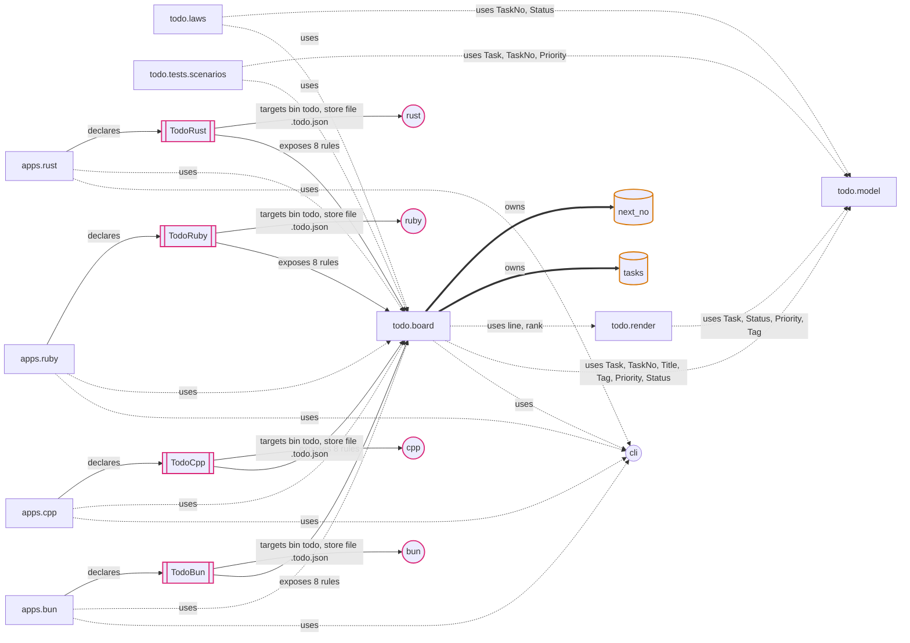

# Modules

> **Generated.** Projection `diagram --kind modules` of the program's IR, printed by the `view` crate. Do not edit: change the source and regenerate. Same source, same bytes.

**20 nodes (4 app, 9 module, 2 state, 4 target, 1 vocabulary), 30 edges (4 declares, 4 exposes, 2 owns, 4 targets, 16 uses).**

## Limits

- Events are not drawn: the IR has no `event` yet.
- A `uses` edge lists the names imported one by one; an edge with no names is a whole-module `use`.
- Places and handlers of an `app` are not drawn; only `@target`, `@bin` and `@store` are read.
