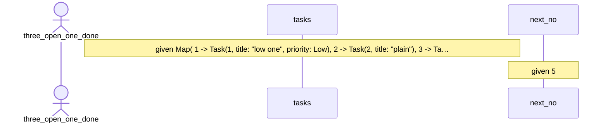
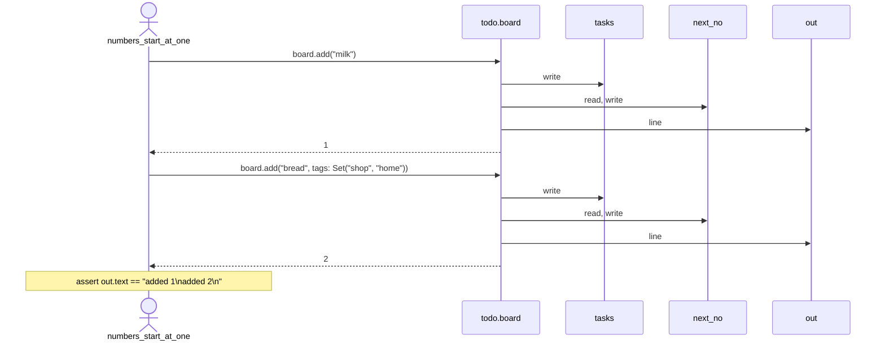
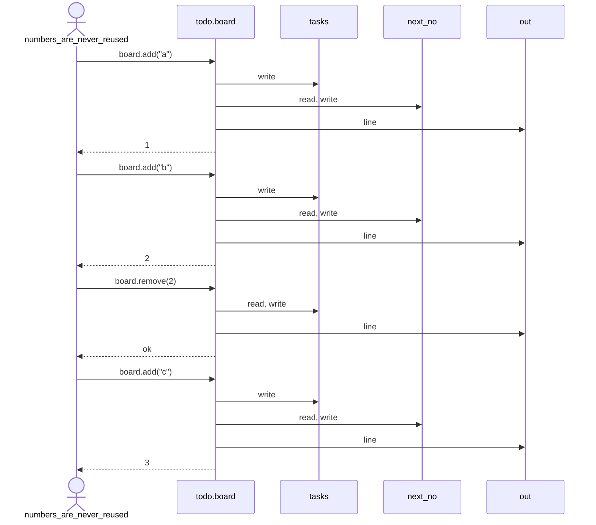
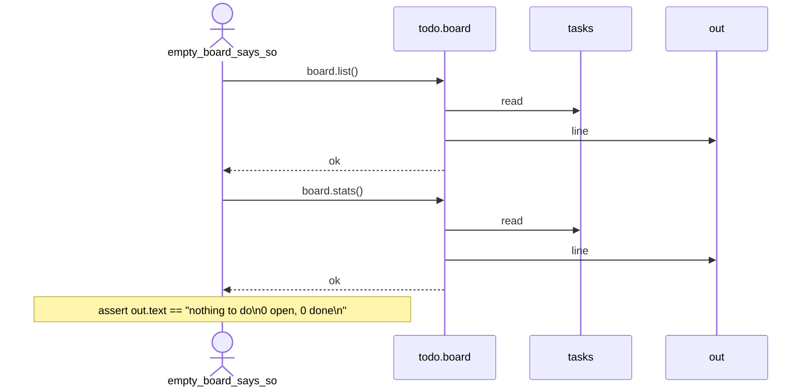
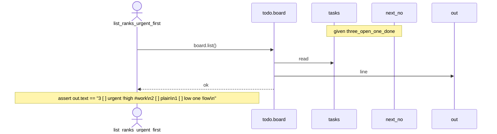
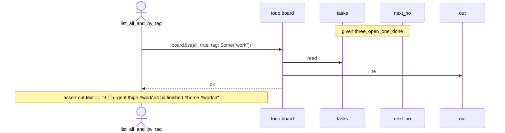
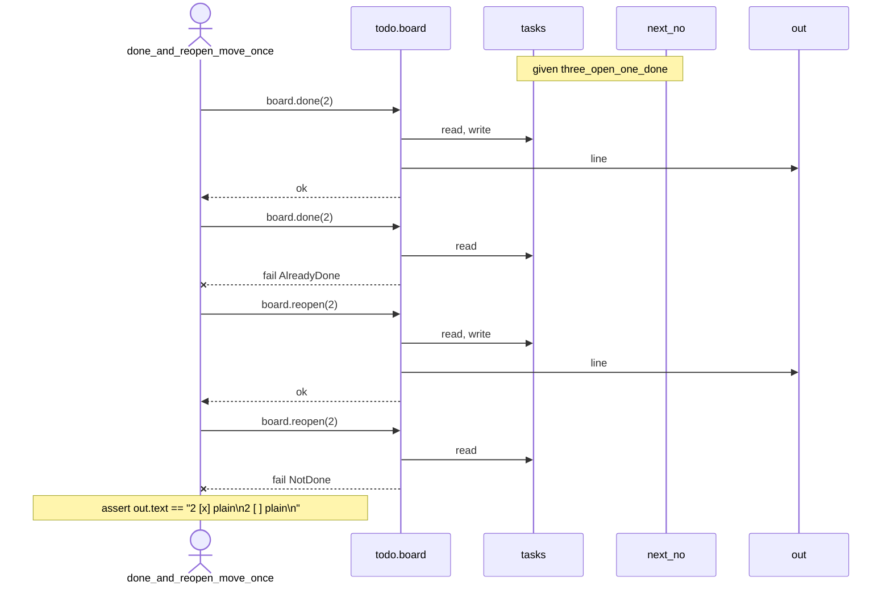
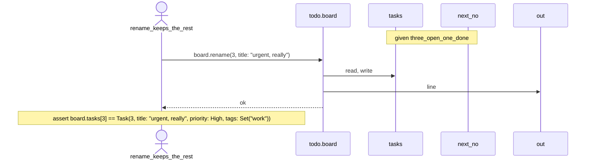
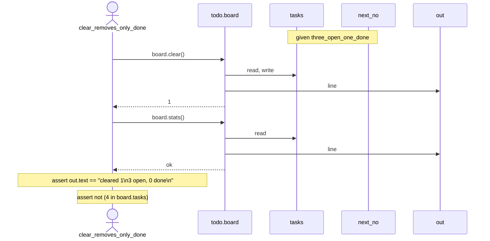
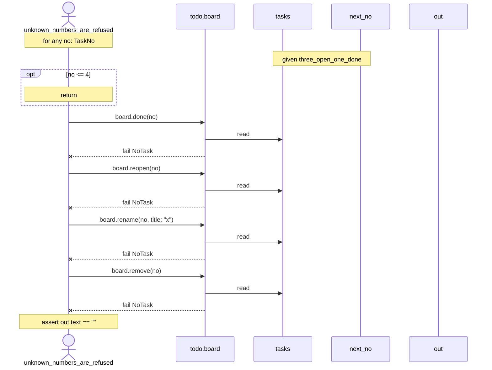

# Sequence diagrams

> **Generated.** Projection `diagram --kind sequence` of the program's IR, printed by the `view` crate. Do not edit: change the source and regenerate. Same source, same bytes.

**10 tests.** One diagram per `test`, read off its body; nothing was run.

| Test | Participants | Messages |
|---|---|---|
| `todo.board.three_open_one_done` | 3 | 0 |
| `todo.tests.scenarios.numbers_start_at_one` | 5 | 10 |
| `todo.tests.scenarios.numbers_are_never_reused` | 5 | 19 |
| `todo.tests.scenarios.empty_board_says_so` | 4 | 8 |
| `todo.tests.scenarios.list_ranks_urgent_first` | 5 | 4 |
| `todo.tests.scenarios.list_all_and_by_tag` | 5 | 4 |
| `todo.tests.scenarios.done_and_reopen_move_once` | 5 | 14 |
| `todo.tests.scenarios.rename_keeps_the_rest` | 5 | 4 |
| `todo.tests.scenarios.clear_removes_only_done` | 5 | 8 |
| `todo.tests.scenarios.unknown_numbers_are_refused` | 5 | 12 |

## `todo.board.three_open_one_done`

## `todo.tests.scenarios.numbers_start_at_one`

## `todo.tests.scenarios.numbers_are_never_reused`

## `todo.tests.scenarios.empty_board_says_so`

## `todo.tests.scenarios.list_ranks_urgent_first`

## `todo.tests.scenarios.list_all_and_by_tag`

## `todo.tests.scenarios.done_and_reopen_move_once`

## `todo.tests.scenarios.rename_keeps_the_rest`

## `todo.tests.scenarios.clear_removes_only_done`

## `todo.tests.scenarios.unknown_numbers_are_refused`

## Limits

- The arrows to state and `out` are everything the called rule can touch, not what this call did touch: no rule is executed.
- A refused call shows the reads of the rule's guards only.
- Calls a rule makes to functions are not drawn; see the call graph.
- A note longer than 96 characters is cut and marked with `…`.
