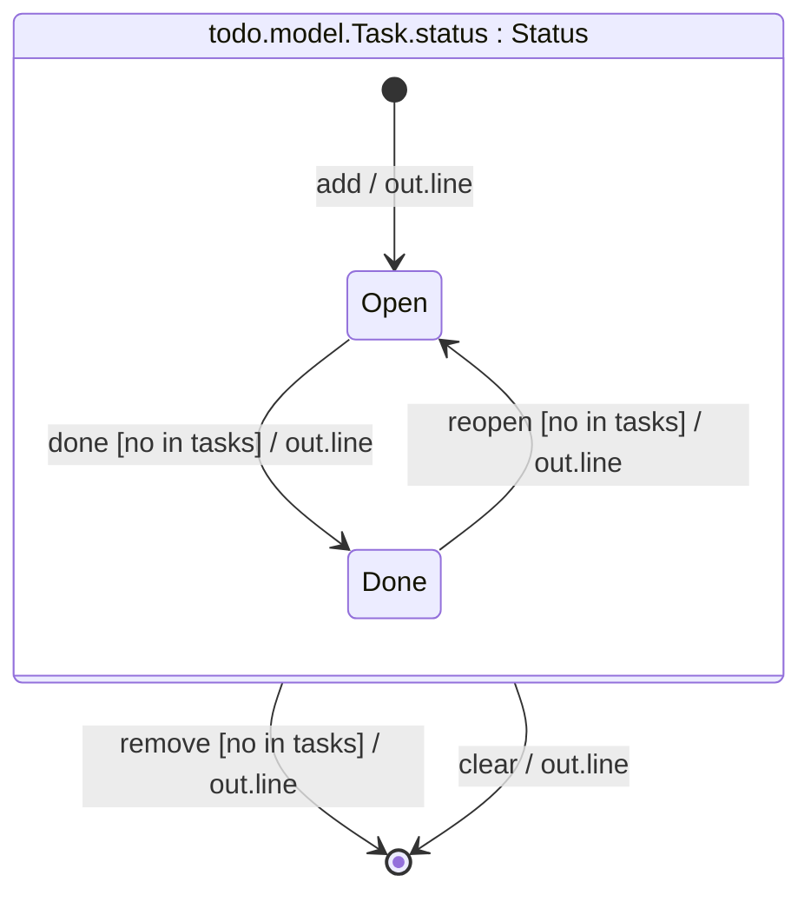

# State diagrams

> **Generated.** Projection `diagram --kind state` of the program's IR, printed by the `view` crate. Do not edit: change the source and regenerate. Same source, same bytes.

**1 machines.** An edge reads `rule [guards] / effects`.

## `todo.model.Task.status`

**3 nodes, 5 edges.**

| From | To | Rule | Other guards | Effects | Read from |
|---|---|---|---|---|---|
| outside | `Open` | `todo.board.add` | - | `out.line` | rule |
| `Open` | `Done` | `todo.board.done` | `no in tasks` | `out.line` | rule |
| `Done` | `Open` | `todo.board.reopen` | `no in tasks` | `out.line` | rule |
| any state | outside | `todo.board.remove` | `no in tasks` | `out.line` | rule |
| any state | outside | `todo.board.clear` | - | `out.line` | rule |

Rules that write state and move no machine: `todo.board.rename`.

Sum-typed places that are set when created and never moved, so not drawn: `todo.model.Task.priority`.

## Limits

- A move is found only where a rule assigns a variant by name; a value passed in or computed is drawn as `(computed)`.
- Where a move starts is read from a guard `place == Variant` or `place.is(Variant)` on the same place text; with no such guard the move is drawn from every state.
- An exit is drawn from any state: which entries a `remove` in a loop takes is not decided here.
- `flow` declarations are drawn only when passed in as data; the IR does not carry them yet.
